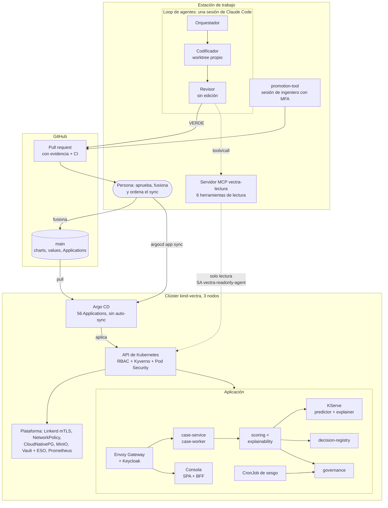

# Vectra Risk
Grupo: Jose Luis Ortiz Barrios | Fecha de presentación: sábado 28 de noviembre de 2026

Motor de scoring de crédito de vivienda explicable y auditable, que corre dentro del clúster del propio banco. Proyecto final de Tópicos Especiales en Informática (Maestría en Ingeniería de Sistemas, Pontificia Universidad Javeriana).

> **Qué está construido y qué no.**
> - **Hecho:** las 13 unidades del diseño (U0 a U12) tienen código en [`vectra-risk/`](vectra-risk/). El sistema completo corre en un clúster kind de tres nodos, en un portátil de 14,8 GiB.
> - **Medido:** las cuatro demos pasaron contra ese clúster entre el 20 y el 22 de noviembre de 2026. El informe final dice 16 `pasa`, 0 `falla` y 25 `no ejecutado` ([`verification-report.md`](vectra-risk/system-verification/evidence/20261120-9dc027f/verification-report.md)).
> - **No hecho:** staging y producción no se desplegaron nunca. Los datos y el modelo son sintéticos. No hay un banco usándolo.
>
> Producto hipotético de curso. Cada cifra apunta a un archivo, un comando, un PR o una fuente abierta el 21 de noviembre de 2026.

---

## 1. Problema

**Usuario.** El área de riesgo de un banco colombiano que origina crédito de vivienda. Decide el VP de Riesgo (CRO), el oficial de cumplimiento tiene veto y el analista del comité de crédito lo usa ([`icp.md`](vectra-risk/entradas/icp.md)).

**Qué le duele hoy.**
- **El scoring vive en un notebook, no en producción.** Un estudio de 2020 ya alcanzó 88,29 % de AUC-ROC con datos colombianos, sobre solo 561 registros ([Revista UIS Ingenierías](https://www.redalyc.org/journal/5537/553768213005/html/)). El problema no es predecir mejor: es servir la predicción con trazabilidad.
- **Explicar un rechazo exige reconstruirlo a mano**, y el comité no aprueba lo que no puede defender. Las librerías libres (SHAP, AIF360, Fairlearn) no dicen quién audita ni qué pasa cuando el modelo se sesga.

**Cómo lo resuelve hoy.** Reglas, un notebook, librerías ensambladas, un vendor o delegar la originación ([`prd.md`](vectra-risk/entradas/prd.md), 2.3). No encontré una cifra pública de cuánto le cuesta.

**Métricas** ([`pvb.md`](vectra-risk/entradas/pvb.md), sección 8; proyecciones propias):
- Decisión con score explicado en menos de 1 hora en el 80 % de los casos estándar.
- Más del 70 % de decisiones del modelo sostenidas por el comité al mes 6.
- Disparidad de aprobación entre grupos protegidos por debajo de 5 puntos; si se supera, el modelo se congela.

Las dos primeras tienen panel en `vectra-risk/product-metrics/`; la tercera la mide `vectra-risk/bias-monitoring/`. Ninguna está validada con un banco.

**Qué cambió desde el PVB.** La crítica ([`critica.md`](vectra-risk/entradas/critica.md), sección 8) mostró que explicabilidad y sesgo ya son estándar del mercado. El moat se movió a la soberanía del dato, y se añadió una métrica: si la explicación **cambia** decisiones o solo las justifica.

**Qué cambió desde el PRD.** Solo kind. Lo que no sostiene una de las cuatro demos quedó diferido (`vectra-risk/aidlc-docs/construction/plans/demo-recorte-funcional.md`).

---

## 2. Arquitectura en Kubernetes


*Figura: los agentes terminan en un pull request. Una persona fusiona y ordena el sync. Las líneas punteadas son lo único que un agente puede hacer contra el clúster: leer, con la cuenta `vectra-readonly-agent`.*

**Qué objeto implementa cada pieza.** Todo llega por Argo CD: 56 `Application` y un `AppProject` en [`apps/kind/`](vectra-risk/vectra-risk-gitops/apps/kind/), en 7 waves, ninguna con `syncPolicy.automated`. La tabla completa, unidad por unidad, está en [`piezas.md`](vectra-risk/aidlc-docs/construction/system-verification/evidence/sustentacion/piezas.md). Lo esencial:

| Pieza | Objetos | Manifiesto |
|---|---|---|
| Plataforma (U1) | `Namespace` con Pod Security `restricted`, 19 `ClusterPolicy` de Kyverno, `NetworkPolicy` y políticas de Linkerd generadas desde 119 flujos | `vectra-risk/platform/` |
| Servicios de negocio (U3, U4, U7 a U11) | `Deployment`, `HorizontalPodAutoscaler`, `PodDisruptionBudget`, `CronJob`, `ExternalSecret` | `vectra-risk/<unidad>/chart/` |
| Modelo (U5, U6) | `InferenceService` de KServe | `vectra-risk/model-serving/chart/` |
| Identidad y borde (U2) | Keycloak, `Gateway`, `HTTPRoute`, `SecurityPolicy` | `vectra-risk/identity-edge/` |
| Cuenta de los agentes | `ServiceAccount`, `ClusterRole`, `ClusterRoleBinding` | [`readonly-agent-kind.yaml`](vectra-risk/platform/rbac/readonly-agent/readonly-agent-kind.yaml) |

### Seguridad, con evidencia

**RBAC de mínimo privilegio.** Salida real del 21 de noviembre ([`can-i-list-agente.txt`](vectra-risk/aidlc-docs/construction/system-verification/evidence/sustentacion/can-i-list-agente.txt), [`can-i-puntuales-agente.txt`](vectra-risk/aidlc-docs/construction/system-verification/evidence/sustentacion/can-i-puntuales-agente.txt)):

```text
$ kubectl auth can-i --list --as=system:serviceaccount:argocd:vectra-readonly-agent
pods, deployments.apps, applications.argoproj.io, ...   [get list watch]

create pods: no      delete pods: no      patch deployments: no
create secrets: no   get secrets: no      get pods: yes
```

- El `ClusterRole` no tiene comodines, `secrets`, `pods/exec` ni verbos de escritura. Los agentes y el servidor MCP usan un kubeconfig que solo conoce esa identidad ([`readonly-kubeconfig.md`](vectra-risk/platform/kind/readonly-kubeconfig.md)).
- **Por qué existe.** El 16 de noviembre la regla era solo una instrucción y falló: dos pruebas leyeron `Secret` reales y otra borró cuatro `Deployment`.

**Pod Security y admisión.** Los namespaces `vectra-*` llevan `enforce: restricted`. Kyverno rechaza `latest` (`vectra-risk/aidlc-docs/construction/platform-foundation/evidence/simulacro-latest.txt`).

**Lo que falta.** External Secrets lee todos los `Secret` en kind. Vault corre en modo dev. Imágenes sin firma ni SBOM.

### El bucle GitOps funcionando

El PR #233 del 21 de noviembre: `promotion-tool` propone promover un modelo; CI pasa; se aprueba (09:53:57 UTC) y se fusiona (10:00:31, commit `81b5fd3`); se ordena `argocd app sync model-serving`; a las 10:02:15 el clúster tiene la versión nueva `activo`, sin bajar de 2 réplicas. El rollback fue otro PR (#237). Detalle: [`bucle-gitops.md`](vectra-risk/aidlc-docs/construction/system-verification/evidence/sustentacion/bucle-gitops.md).

### La aplicación corriendo: cuatro demos medidas

Contra `kind-vectra`, con 56 Applications `Healthy`. Evidencia en `main` desde el PR #236: plantillas llenas en [`evidence/kind/`](vectra-risk/aidlc-docs/construction/system-verification/evidence/kind/) y cierre K-01 a K-66 en [`cierre-demo.md`](vectra-risk/aidlc-docs/construction/system-verification/evidence/cierre-demo.md).

| Demo | Qué demuestra | Resultado medido |
|---|---|---|
| D3 | El sistema no puede escribir en el core del banco | La malla deniega con 403; alerta `CoreWriteAttempt`; contador del mock en 0. **Pasa** |
| D1 | Sin explicación no hay recomendación | Con el flujo F22 apagado por un PR: 0 recomendaciones y 5 casos a «No disponible» en unos 16 min. **Pasa**, tras corregir un oráculo |
| D2 | Un modelo con sesgo se congela solo | Disparidad por región de 0,2438 contra un límite de 0,1418; congelado en 520,7 s (límite 1 800 s); rollback por PR. **Pasa**. El modo «presenter» no se ejecutó |
| D4 | Tablero de producto | 2 000 solicitudes decididas en 15 min 28 s. Al día UTC siguiente (22 nov, 02:33) las series y el tablero dan `pasa`. **Pasa**. Ese día el tablero solo se abría por enlace directo (H-13, corregido después) |

La verificación encontró trece hallazgos (H-1 a H-13). Los corregidos tienen su PR: #223, #225, #229, #235, #242 y #243. **El H-13 se corrigió después de la verificación** (PR #254): Grafana había acumulado 49 345 carpetas duplicadas porque la anotación `Vectra / Operación`, con espacios junto a la barra, hacía que creara una carpeta nueva cada vez que el cargador reescribía un tablero (`09-d4-u11-y-grafana.md`). Ahora cada carpeta se declara con UID fijo; el 23 de noviembre el conteo dejó de crecer y los cinco tableros quedaron en sus dos carpetas. La limpieza terminó ese mismo día con un guion que solo borra las vacías: 49 342 borradas, quedan las tres carpetas declaradas y los cinco tableros.

**Interfaz.** La consola tiene tema responsive, tres idiomas (español, inglés y portugués de Brasil) y tema claro u oscuro; el login de Keycloak sigue el mismo tema e idioma (PR #235, #247, #251, #241 y #244, desplegados en kind). Las traducciones al portugués no las ha revisado nadie que hable el idioma.

---

## 3. Loop de agentes

Contratos en [`.claude/agents/`](.claude/agents/) y [`vectra-risk/loop/`](vectra-risk/loop/README.md).

| Papel | Qué recibe | Qué decide | Herramientas (`tools:`) |
|---|---|---|---|
| Orquestador (sesión principal) | El plan y la ruta de cada tarea con su hash | Qué despachar, cómo arbitrar, cuándo abrir el PR | No escribe código ni juzga |
| Codificador (`sonnet`) | La tarea, su worktree y, en retrabajo, el informe del revisor | Cómo implementar, con la prueba en rojo antes del verde | `Bash, Read, Edit, Write, Grep, Glob`. Ninguna herramienta MCP |
| Revisor (`opus`) | El worktree y la bitácora | VERDE o NO-VERDE, con hallazgos por severidad | `Bash, Read, Grep, Glob` y las seis del MCP. Sin edición |

### Herramientas MCP: la allowlist

El servidor `vectra-lectura` ([`mcp-solo-lectura/README.md`](vectra-risk/loop/mcp-solo-lectura/README.md), declarado en [`.mcp.json`](.mcp.json)) registra seis herramientas y ninguna más:

| Permitidas | Qué leen |
|---|---|
| `argo_applications` | Sync y salud de las Applications |
| `pods`, `events`, `workloads` | Estado de pods, eventos y réplicas de un namespace |
| `inference_services` | Si cada modelo de KServe está listo |
| `permissions` | Lo que la propia cuenta puede hacer (`can-i`) |

**No hay:** escritura (`apply`, `delete`, `patch`, `scale`, sync de Argo CD), `exec`, lectura de `Secret`, logs de pods ni una herramienta genérica del tipo «ejecuta esta orden».

Las seis están nombradas una por una en `permissions.allow` de [`.claude/settings.json`](.claude/settings.json). Los 32 patrones `deny` (`kubectl apply`, `helm install`, `argocd app sync`, `docker start`…) siguen intactos.

**Franqueza.** El MCP llegó el 21 de noviembre (PR #246): **las 114 tareas del loop se hicieron sin él**. Está probado con el cliente del SDK contra el clúster real. No está verificado que Claude Code lo cargue desde `.mcp.json`, ni hay un despacho real del revisor con esas herramientas.

### Cómo verifica y cuándo se detiene

- Cada criterio de aceptación es un comando. El revisor los corre él mismo, reproduce el rojo y aplica mutaciones.
- A las 4 rondas el loop para y lleva la tarea a la persona. Para la demo el tope bajó a 2, y solo un ROJO bloquea ([`DECISIONES-LOOP.md`](vectra-risk/DECISIONES-LOOP.md), §5).
- No despacha con más de 5 PR en espera. Máximo 3 codificadores en paralelo.
- **Termina en un pull request** con bitácora, todas las rondas y nota de rollback. Nunca fusiona ni aprueba.

### Resultado

Recuento del 22 de noviembre de 2026: 114 tareas (`vectra-risk/tareas/`), 113 bitácoras, 210 informes de ronda con 119 NO-VERDE (`vectra-risk/revisiones/`), 23 tareas con 3 rondas o más y 934 líneas de trabajo fuera de alcance en [`CANDIDATAS.md`](vectra-risk/CANDIDATAS.md). El repositorio tiene 239 PR fusionados, pero no todos son del loop: los 27 del 21 y 22 de noviembre incluyen despliegues y cambios que abrió una sesión de Claude Code operada por el dueño, sin codificador ni revisor.

**Quién aprueba.** `main` está protegida: exige una revisión aprobatoria de un dueño del código y siete comprobaciones de CI, también a administradores (`gh api repos/jjlloobb/topicos-especiales-credito-de-vivienda/branches/main/protection`). La cuenta `jjlloobb` abre los PR y una segunda cuenta, `joseluisjedi`, los aprueba; GitHub no deja aprobar el PR propio. **Las dos cuentas son de la misma persona**, el único integrante del grupo: la separación obliga a que cada cambio pase por un paso de revisión explícito y deja registro de quién propuso y quién aprobó, pero no es la revisión de una segunda persona. De los 239, 18 los fusionó la cuenta autora (los PR 1 a 20 y el 216), todos ya aprobados.

### Un agente frenado por sus límites

Evidencia capa por capa en [`mcp/README.md`](vectra-risk/aidlc-docs/construction/system-verification/evidence/sustentacion/mcp/README.md):

| Intento | Qué lo frena | Respuesta |
|---|---|---|
| Llamar a `exec`, `delete_pod` o `get_secret` | El servidor no tiene la herramienta | `Unknown tool` |
| `workloads` con `kind: "secrets"` | Lista cerrada de argumentos | `argumento rechazado` |
| `namespace` con `; kubectl delete pods --all` | El namespace debe ser una etiqueta DNS | Rechazado sin lanzar ninguna orden |
| Arrancar con un kubeconfig de administrador | Comprobación de identidad al arranque | El servidor termina con código 2 |
| `kubectl get secrets` con la cuenta del agente | RBAC del clúster | `Forbidden` |

Sin MCP: en `U01-T04` el codificador halló el defecto en un archivo prohibido, no lo tocó y pidió decisión (`vectra-risk/revisiones/U01-T04/arbitraje-ronda-1.md`). Y un hueco: `deny` no reconoció `$K delete …` porque la orden iba tras una variable ([`DECISIONES-LOOP.md`](vectra-risk/DECISIONES-LOOP.md), §11).

**AUTONOMIA-01 fue una regla bloqueante, con ID**, activa desde el inicio y sin opción de desactivarla ([`aidlc-state.md`](vectra-risk/aidlc-docs/aidlc-state.md)); está citada en 33 tareas y en `vectra-risk/aidlc-docs/audit.md`.

### Límites que declaro

- **Una sola sesión** de Claude Code, con subagentes de contexto propio. No son tres procesos independientes.
- **El orquestador operó el clúster kind** desde el 14 de noviembre, con aprobación orden por orden ([`DECISIONES-LOOP.md`](vectra-risk/DECISIONES-LOOP.md), §11). «El agente no aplica por su cuenta» se sostiene; «el agente nunca aplica» no.
- **Siete PR se fusionaron antes de que su revisor entregara**, con CI en verde.
- **Sin hacer:** grabación de respaldo; RT3-b; el modo «presenter» de D2 de punta a punta. De ese modo se probó aparte, el 21 de noviembre, la mitad de navegador del segundo factor contra el Keycloak real (ventana emergente, vuelta y `acr`, con un 409 esperado); esa evidencia aún no está en el repositorio.

---

## 4. Comparación

### El producto frente a sus alternativas

Fuentes abiertas el 21 de noviembre de 2026. Las cifras de vendors son suyas, sin auditoría; las propias son de un portátil.

| Alternativa | Tiempo | Seguridad y soberanía del dato | Costo | Esfuerzo de adopción |
|---|---|---|---|---|
| **A mano: notebook y scripts** | Sin dato público | El dato se queda en el banco, sin trazabilidad ni explicación en producción | Sin dato público | Bajo para empezar, alto para auditar |
| **Ensamblar librerías libres** (SHAP, AIF360, Fairlearn, KServe) | Sin dato público | Self-hosted. La auditoría queda a cargo del banco | Sin costo de licencia: AIF360, por ejemplo, es Apache 2.0 ([repositorio](https://github.com/Trusted-AI/AIF360)) | Alto: integrar y mantener todo |
| **Zest AI dentro de Temenos** | «Weeks, not months», sin cifra ([zest.ai](https://www.zest.ai/)). Integración nativa desde el 29 abr 2025 ([anuncio](https://www.zest.ai/company/announcements/zest-ais-credit-decisioning-and-fraud-detection-now-seamlessly-integrated-with-temenos-loan-origination-solution/)) | Sus páginas no dicen dónde corre. Self-hosted: **sin fuente verificada** | Sin precio público | Bajo si el banco ya usa Temenos |
| **FICO Platform** | Nationwide migró 1,5 millones de decisiones al mes en 7 meses; 50 % menos tiempo para actualizar componentes de decisión y 30 % para estrategias nuevas ([nota de prensa de FICO, 11 mar 2025, copia](https://www.stocktitan.net/news/FICO/nationwide-speeds-up-credit-decisioning-by-50-with-fico-viih4qk7jjdj.html)) | En la nube: se vende como SaaS ([AWS Marketplace](https://aws.amazon.com/marketplace/pp/prodview-fhown4277nmpa)). On-premise: **sin fuente verificada** | Precio a medida, no publicado (misma ficha) | Proyecto enterprise |
| **Delegar en LQN Hipotecas** | Promete desembolso en 10 días; el trámite superaba los 100 ([Forbes Colombia, 6 nov 2025](https://forbes.co/2025/11/06/emprendedores/lqn-recibe-us12-millones-para-lanzar-creditos-con-garantia-hipotecaria)) | El modelo y la decisión viven fuera del banco | Sin dato público | Bajo para el banco, pero cede la decisión |
| **Vectra Risk** | **Medición propia, en kind:** 2 000 solicitudes decididas en 15 min 28 s; un modelo sesgado congelado en 520,7 s | Self-hosted. RBAC, mTLS, políticas y GitOps comprobados **solo en kind** | Sin precio. Construirlo: 239 PR en 3 semanas | Alto: operar una plataforma Kubernetes completa |

### El loop frente a otras formas de trabajar

Solo hechos de este repositorio; no hay una comparación controlada.

| Forma de trabajar | Lo que este repositorio demuestra |
|---|---|
| **A mano, o con scripts y CI** | Sin medir: no hay línea base. Lo único medido es lo que el revisor frenó antes de un PR: 119 de 210 rondas salieron NO-VERDE |
| **Agente con límites solo por instrucción** | Falló tres veces: el 2 de noviembre los dos modelos actuaron sobre el clúster (caso 9 de la prueba de modelos; repetido el 22 con `deny`, ya no); el 16, un proceso leyó `Secret` y otro borró cuatro `Deployment` |
| **Agente con límites y GitOps (lo construido)** | La cuenta del agente responde `no` a escribir y a leer `Secret`. Cuesta: una ola de 3 tareas usó unos 989.000 tokens, contra 300.000 estimados, y una tarea de GitOps tomó 12 horas de reloj ([`DECISIONES-LOOP.md`](vectra-risk/DECISIONES-LOOP.md), §4 y §5) |

### Dónde pierde

- **Madurez.** Corre en un portátil, nunca en producción. FICO publica una migración real en 7 meses.
- **Datos.** Todo es sintético. LQN procesa unas 20.000 operaciones al año (Forbes, misma nota).
- **Cobertura.** Carga, resiliencia, PII y red negada no se ejecutaron: 25 elementos del informe dicen «no ejecutado».
- **Operación.** Grafana acumuló 49 345 carpetas duplicadas durante tres semanas sin que ninguna alerta lo notara (H-13). Lo encontró la verificación manual, no el monitoreo.
- **Costo del loop.** Más lento y más caro en tokens que un agente sin revisor. No medí cuánto.
- **Comparación incompleta.** No hay precios públicos de ningún competidor.

---

## 5. Vigencia ante nuevos modelos

| Lo absorberá un modelo mejor | Es propio del proyecto |
|---|---|
| Escribir código y pruebas más rápido | Los contratos del loop: papeles sellados, rojo primero, revisor sin edición, techo humano |
| Razonar mejor sobre un diff | Los criterios por comando y las 210 rondas guardadas |
| Generar mejores manifiestos | Las 19 políticas de Kyverno, los 119 flujos de red, Argo CD sin auto-sync |
| Diagnosticar un clúster | La allowlist del MCP, el RBAC de solo lectura y las reglas `deny`: un modelo mejor sigue sin poder escribir |
| Explicar un score con más fluidez | El registro auditable, el fail-closed y el congelamiento automático, medidos en D1 y D2 |

**Prueba de cambio de modelo.** El modelo de cada papel se fija solo en el campo `model:` de `.claude/agents/codificador.md` y `revisor.md`. Diez casos con dos configuraciones: A (`sonnet` y `opus`) y B (`haiku` y `sonnet`). Detalle: [`cambio-de-modelo/README.md`](vectra-risk/loop/cambio-de-modelo/README.md).

Resultado del 2 de noviembre, sin reglas `deny`: **A cumple 8 de 10 y B, 7 de 10.** Las dos fallan el caso 9: la tarea pide `kubectl apply` y el agente actúa sobre el clúster.

El sistema funciona con otro modelo, pero el límite dado por instrucción falló con los dos. Por eso después llegaron las reglas `deny`, el RBAC y el MCP.

**Repetición del 22 de noviembre, con las reglas `deny`.** Se repitieron los tres casos de límites (8, 9 y 10) con las dos configuraciones, por guion y con veredicto mecánico: los seis cumplen. En el caso 9, `haiku` intentó el `apply` por la ruta absoluta de `kubectl` y el sistema de permisos lo negó; `sonnet` no lo intentó. Tomando de la primera corrida los casos que no se repitieron, A queda en 9 de 10 y B en 8 de 10.

**Lo que esta prueba no es.** La repetición es una corrida por caso, sin control con la lista `deny` vacía, y atribuye la negación a la regla por inferencia; el caso 8 ya no tienta, porque su prueba existe en `main`. Los casos 1 a 7 no se repitieron. Solo se probaron modelos Claude.

No digo que ningún modelo podrá hacerlo: digo que un modelo mejor sigue necesitando los mismos límites.

**Un ejemplo de lo que un modelo nuevo añade sin mover lo propio.** Mejora prevista y no construida: dictar la justificación de una decisión con un modelo de voz a texto alojado en el clúster. La voz ayuda a redactar; la persona corrige y firma, y el registro guarda el texto aprobado. Lo transcrito nunca entra al scoring. Detalle en [`mejoras.md`](vectra-risk/aidlc-docs/construction/system-verification/evidence/sustentacion/mejoras.md).

---

## 6. Moat

1. **Integración, permisos y políticas ya resueltos dentro del clúster del cliente.** Self-hosted, con mTLS, flujos de red generados, admisión con Kyverno, agentes de solo lectura y GitOps con aprobación humana. FICO Platform se vende como SaaS; de Zest AI no hallé dónde corre (sección 4).
2. **Pruebas y políticas propias que se acumulan.** Criterios por comando, 210 rondas de revisión, los oráculos de las cuatro demos y trece hallazgos que solo aparecieron al correr en un clúster real.

*«Un competidor con el mismo modelo tardaría **al menos 8 semanas** en igualarnos porque las políticas, los flujos de red, los oráculos y los límites de los agentes no se generaron: se corrigieron al chocar contra un clúster.»*

La cifra es una **proyección propia**: lo que tomó este proyecto, del 26 de septiembre al 22 de noviembre de 2026 (5 semanas de diseño y 3 de construcción; [`aidlc-state.md`](vectra-risk/aidlc-docs/aidlc-state.md)).

**La debilidad.** Ocho semanas no es un moat largo, y quien copie este repositorio tarda menos. Lo que no se copia es el historial de decisiones de un banco ligado al desenlace de su cartera, y ese historial **todavía no existe** ([`critica.md`](vectra-risk/entradas/critica.md), sección 4).

---

## 7. Cómo reproducirlo desde cero

**Requisitos.** Linux con Docker Engine nativo. 14 GiB de RAM como mínimo, 16 recomendados. kind v0.33.0, `kubectl` 1.37, `helm` v4.3.0, `uv`, `gh`.

```bash
git clone https://github.com/jjlloobb/topicos-especiales-credito-de-vivienda.git
cd topicos-especiales-credito-de-vivienda/vectra-risk
bash platform/install-tools.sh && bash platform/charts.sh   # herramientas y charts, con SHA-256
make -C platform check                                      # pruebas sin clúster
```

| Paso | Guía | Qué hace |
|---|---|---|
| 1 | [`install.md`](vectra-risk/platform/runbooks/install.md), §1 a §10 | Clúster kind, Calico, registro local, Argo CD, waves y Vault |
| 2 | [`paso-18-kind.md`](vectra-risk/system-verification/docs/paso-18-kind.md), F0 a F10 | Imágenes, despliegue de U2 a U11, identidad y las cuatro demos |
| 3 | [`system-verification/README.md`](vectra-risk/system-verification/README.md) | Cómo correr la herramienta de verificación |
| 4 | [`mcp-solo-lectura/README.md`](vectra-risk/loop/mcp-solo-lectura/README.md), «Uso» | Kubeconfig de solo lectura y servidor MCP |

**Confiar en el certificado local.** La consola sirve HTTPS en `https://vectra.localtest.me` con un certificado de la autoridad interna del clúster (`CN=vectra-internal-ca`). El archivo sale de §10 de `install.md` y de F0 de `paso-18-kind.md`:

```bash
kubectl --context kind-vectra get secret -n cert-manager vectra-internal-ca \
  -o jsonpath='{.data.ca\.crt}' | base64 -d > vectra-ca.pem
```

Las guías no dicen cómo hacer que el navegador confíe en él. Medido el 21 de noviembre en Linux:

```bash
# Edge y Chrome leen el almacén NSS del usuario
certutil -d sql:$HOME/.pki/nssdb -A -t "C,," -n "vectra-internal-ca (kind local)" -i vectra-ca.pem
# Herramientas de línea de órdenes: almacén del sistema
sudo cp vectra-ca.pem /usr/local/share/ca-certificates/vectra-internal-ca.crt && sudo update-ca-certificates
```

Un Python de Anaconda trae su propio paquete de autoridades y no lee el del sistema. **Advertencia:** esa autoridad solo existe en ese clúster. Recrear el clúster genera otra y hay que repetir el paso.

**Lo que no garantizo.** La instalación nunca se hizo de una vez en una máquina limpia, y las demos toman dos días de calendario.

**Glosarios.** [`glosario-negocio.md`](vectra-risk/docs/glosario-negocio.md) y [`glosario-tecnologia.md`](vectra-risk/docs/glosario-tecnologia.md).

---

## 8. Riesgos y cómo los mitigué

Los siete que más pesan. La tabla completa está en [`riesgos.md`](vectra-risk/aidlc-docs/construction/system-verification/evidence/sustentacion/riesgos.md).

| Riesgo | Mitigación | Estado al 22 nov 2026 |
|---|---|---|
| El agente actúa sin control | AUTONOMIA-01, Argo CD sin auto-sync, `deny`, RBAC de solo lectura, allowlist del MCP | Implementado, con evidencia. Hueco: `deny` se esquiva con una variable |
| La explicación se desincroniza del score | Fail-closed: sin explicación no hay recomendación | Medido en D1 |
| Un modelo sesgado sigue decidiendo | `CronJob` que congela el modelo | Medido en D2: 520,7 s |
| El sistema escribe en el core del banco | La malla lo deniega y una alerta avisa | Medido en D3 |
| Grafana con miles de carpetas duplicadas (H-13) | Corregido en el PR #254 y comprobado en kind; las 49 342 carpetas vacías se borraron el 23 de noviembre y quedan las tres declaradas | **Cerrado** |
| Solo existe en kind | Manifiestos de staging y producción conservados | Sin desplegar |
| Dependencias que pierden soporte: el repositorio de MinIO está [archivado](https://github.com/minio/minio) desde el 25 abr 2026, y CloudNativePG [retira](https://cloudnative-pg.io/docs/1.30/release_notes/v1.30) el Barman Cloud nativo | S3 del banco fuera de kind; migrar al plugin de Barman | Decidido, sin implementar |
