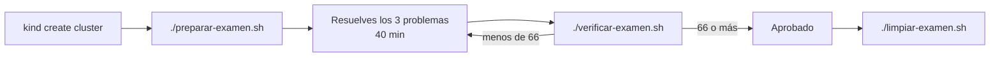

# Examen práctico CKA/CKAD (estilo examen, calificado por script)

**Módulo 7 · 40 minutos · 100 puntos · se aprueba con 66**

Tres problemas, tres sistemas rotos y un script que califica **el estado final del clúster**,
no los comandos que tecleaste. Como en el examen real de la Linux Foundation: hay un
objetivo, un terminal con `kubectl` y nada más. Nadie te dice qué está roto.



---

## Requisitos

| Herramienta | Versión con la que se probó |
|---|---|
| Docker | cualquiera reciente (kind corre los nodos como contenedores) |
| kind | v0.33.0 |
| kubectl | v1.37.0 (el clúster es v1.37.0) |
| curl y python3 | los trae casi toda distribución Linux |

Los scripts son bash y hablan con los nodos por `docker exec`, así que **funcionan solo con
kind**, no con un clúster remoto.

## 1. Crear el clúster

Un control-plane y un worker. kindnet, el CNI que trae kind, hace cumplir las
NetworkPolicy (lo comprobarás en el problema 3).

```bash
kind create cluster --name examen-cka-ckad --config kind-examen.yaml
kubectl config use-context kind-examen-cka-ckad
kubectl get nodes     # al principio los nodos salen NotReady; espera ~30 s y repite hasta ver Ready
```

> Si compartes máquina con otros clústeres, trabaja con un kubeconfig propio:
> `export KUBECONFIG=$HOME/examen.kubeconfig` antes de crear el clúster.

## 2. Preparar el examen

```bash
./preparar-examen.sh          # los tres problemas
# o uno a uno:
./preparar-01-pod-estatico.sh
./preparar-02-memoria.sh
./preparar-03-red.sh
```

Los scripts son idempotentes: repetirlos reinicia el problema a su estado roto.

**Regla de honor:** no leas los `preparar-*.sh` ni `verificar-examen.sh` antes de entregar.
Son una venda de cortesía, no un secreto: leerlos te quita justo la parte que se evalúa,
diagnosticar. Aquí la disciplina la pones tú.

## 3. Calificar

```bash
./verificar-examen.sh
```

Tarda entre 30 y 60 segundos (observa el clúster durante 20 s o más para detectar arreglos falsos).
Imprime una línea `[PASA]` o `[FALLA]` por comprobación, los puntos de cada problema y el
total. Sale con código 0 si aprobaste y 1 si no. Puedes calificar las veces que quieras.

| Problema | Tema | Puntos |
|---|---|---|
| 1 | Pod estático | 30 |
| 2 | Memoria | 40 |
| 3 | Red | 30 |

Cada problema es todo o nada: o cumples todas sus comprobaciones o no sumas. Se castigan los
atajos que hacen desaparecer el síntoma sin arreglar el sistema.

## 4. Limpiar

```bash
./limpiar-examen.sh
kind delete cluster --name examen-cka-ckad   # opcional
```

---

## Los problemas

### Problema 1: el Pod que no se va (30 puntos)

En el namespace `examen1` hay un Pod llamado `vigia-...`. Debes **eliminarlo de forma
permanente**: que no exista ahora y que siga sin existir minutos después.

### Problema 2: reporte inestable (40 puntos)

En el namespace `examen2` vive el Deployment `reporte`. Su Pod no logra mantenerse en
ejecución. Hazlo funcionar de forma estable, **sin cambiar lo que la aplicación hace**: sigue
reservando los mismos 150 MB de datos. Debe quedar `Ready`, sin reinicios, con un límite
de memoria razonable.

### Problema 3: la app que nadie alcanza (30 puntos)

En el namespace `examen3` corre el Deployment `web` y lo expone el Service `web` en el
NodePort `30080`. Desde fuera del clúster, `http://<IP-de-un-nodo>:30080/` no responde.
Haz que la aplicación sea alcanzable por el NodePort y responda `200`.

---

## Estado inicial esperado

**Salida real de esta máquina**, justo después de `./preparar-examen.sh` y sin arreglar nada:

```
Problema 1: Pod estático (30 puntos)
  [FALLA] La causa raíz del Pod ya no existe en ningún nodo
  [FALLA] El Pod vigia desaparece y sigue ausente 20 s después
  => 0/30 puntos
Problema 2: Memoria (40 puntos)
  [FALLA] El Deployment reporte tiene 1 réplica Ready
  [PASA]  La carga no cambió: sigue reservando 150 MB (no vale bajar MB)
  [FALLA] Los recursos del contenedor alcanzan para la carga (memoria >= 160 MiB)
  [PASA]  La memoria pedida es razonable (<= 1024 MiB, no vale pedir medio nodo)
  [FALLA] Ningún Pod vivo de reporte reinició durante la espera
  [FALLA] Ningún Pod vivo de reporte tiene terminaciones forzosas en su historial
  => 0/40 puntos
Problema 3: Red (30 puntos)
  [FALLA] La causa raíz del bloqueo ya no existe
  [PASA]  El Deployment web sigue con 1 réplica Ready
  [PASA]  El Service web sigue siendo NodePort 30080
  [FALLA] GET http://172.18.0.2:30080/ desde el host responde 200
  => 0/30 puntos

Resultado: 0/100 puntos (se aprueba con 66)
```

Las líneas `[PASA]` que quedan al inicio (carga de 150 MB, memoria pedida <= 1024 MiB,
Deployment `web` Ready, Service en 30080) son condiciones que **no debes romper** al arreglar:
pasan porque el sistema todavía no ha cambiado. Las comprobaciones de estabilidad del problema 2
(sin reinicios, sin `OOMKilled`) solo pasan si el Pod está `Running` y `Ready`; un Pod atascado
en `CrashLoopBackOff` nunca las pasa. Lo que cuenta es el total por problema.

## Método sugerido

El mismo del módulo 6: **el estado del recurso ya nombra la causa**. `get`, luego `describe`
y sus eventos, luego los recursos vecinos. En el examen real no se pierde tiempo adivinando:
se lee lo que el clúster ya está diciendo.

## Para profundizar

- Pods estáticos: <https://kubernetes.io/docs/tasks/configure-pod-container/static-pod/>
- Unidades de recursos y límites de memoria: <https://kubernetes.io/docs/concepts/configuration/manage-resources-containers/>
- NetworkPolicy: <https://kubernetes.io/docs/concepts/services-networking/network-policies/>
- Currículo CKA y CKAD: <https://github.com/cncf/curriculum>

---

_Hecho con ❤️ por Luis Felipe Ariza Vesga._
