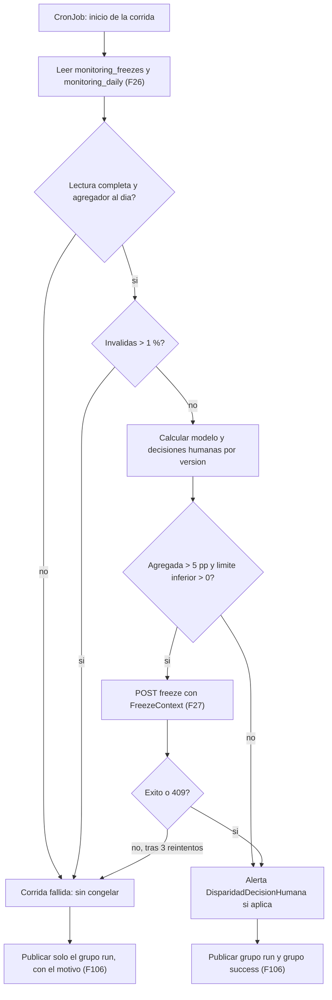

# Modelo de lógica — U9 `bias-monitoring`

## 1. Módulos lógicos

| Proceso | Módulo | Responsabilidad | Reglas |
|---|---|---|---|
| librería (`vectra_disparity`) | `counts` | `counts_from_records(records) -> dict[atributo, CountTable]`; `CountTable` a partir de los conteos de un rango | BR-U9-07 |
| librería | `disparity` | `disparity_by_band(counts, attribute, n_min) -> AttributeResult`: celdas, diferencias por banda, Newcombe, agregada ponderada y su intervalo | BR-U9-01..06 |
| librería | `stats` | Funciones puras: intervalo de Wilson, diferencia de Newcombe, combinación de varianzas | BR-U9-03, 04 |
| CronJob | `run` | Una corrida: leer, calcular, decidir, congelar, publicar | BR-U9-08..12, 20 |
| CronJob | `freeze_rule` | `decide(result, threshold, ...) -> FreezeDecision` (pura) | BR-U9-11 |
| CronJob | `context` | `build_context_package(...) -> FreezeContext` (pura sobre los tres resultados) | BR-U9-15 |
| CronJob | `freeze_client` | La única llamada a governance (`freeze`), con reintentos, con el cliente `bias-monitoring-job` | BR-U9-12 |
| CronJob | `window` | Inicio de la ventana por versión: primer día con datos o día siguiente a la última reactivación (pura) | BR-U9-08 |
| CronJob | `publish` | Gauges al Pushgateway en dos grupos (`success` solo en corridas completas; `run` siempre), sin tasas de celdas insuficientes | BR-U9-20 |
| servicio | `dashboard` | `get_disparity` con caché de 15 min | BR-U9-18 |
| servicio | `freezes` | `list_freezes`, `get_context_package` | BR-U9-19 |
| servicio | `compare` | `compare_source` | BR-U9-17 |

La librería no tiene E/S ni dependencias de red; la usan el CronJob, el servicio, el
`model-validation-job` de U4 y U5. `stats`, `disparity`, `freeze_rule` y `context` son
puras.

## 2. Flujos

### 2.1 Corrida (cada 15 min)



### Alternativa en texto

```text
CronJob cada 15 min
  leer monitoring_freezes (última reactivación por versión) y versions de monitoring_daily (F26)
     la ventana de cada versión empieza en max(primer día con datos, día siguiente a la última reactivación)
  pedir monitoring_daily (POST …:query) en solicitudes de ≤ 12 rangos; la primera lleva unattributable_range = hoy-29..hoy
     y devuelve unattributable_invalid, un único valor por solicitud (4 rangos por versión: antes, después y 7 días de modelo;
     después de humana), sumados en U3 (F26); con más de 3 versiones, varias solicitudes, sin omitir ninguna
     falla, incompleta o agregador atrasado > 30 min -> corrida fallida
  inválidas / total > 1 % -> corrida fallida; si hay alguna -> BiasInvalidEntries y log de seq
  por cada versión con recomendaciones hoy o ayer:
     modelo  = disparidad de hoy-29 a hoy (BR-U9-01..05)
     humana  = disparidad de hoy-29 a hoy por decided_at + tasa de apartamiento
     decide(modelo): agregada > 5 pp y límite inferior > 0 ?
        sí -> FreezeContext(antes hoy-36..hoy-7, después hoy-29..hoy, últimos 7 días hoy-6..hoy) -> POST freeze (F27)
              éxito o 409 -> sigue ; timeout/5xx/circuito -> 3 reintentos -> corrida fallida + BiasFreezeFailed
     decide(humana) -> solo alerta DisparidadDecisionHumana; nunca freeze
  publicar (F106), siempre con PUT y gauges:
     grupo run: métricas de la corrida, motivo de falla, freeze_failed, rule_met, inválidas (también si falló)
     grupo success: last_success_timestamp, solo si la corrida fue completa
     Pushgateway caído -> log del error y código de salida distinto de cero; el freeze ya aplicado no cambia
```

### 2.2 `compare_source` (F25)

```text
governance -> POST /v1/source-comparisons {source_id, pre, post}   (tablas de conteo por atributo)
  validar tablas (catálogo de U0, conteos >= 0, cuatro atributos) -> 422 si no
  disparity_by_band(pre), disparity_by_band(post), delta = post - pre
  -> PrePostReport (sin guardar nada)
```

### 2.3 Dashboard y congelamientos (F14)

```text
BFF (cumplimiento, cro) -> governance list_models(state=activo,congelado) (F11) -> versión servible
BFF -> GET /v1/disparity?version=<servible>&attribute&window
  sin version: bias usa la versión con las recomendaciones más recientes (BR-U9-18)
  caché 15 min por filtro; si no: leer monitoring_daily (POST …:query, F26) y calcular
  -> DisparityView con disclaimer
BFF (cumplimiento, cro) -> GET /v1/freezes               -> monitoring_freezes (F26) -> list[FreezeSummary]
BFF (cumplimiento)      -> GET /v1/freezes/{id}          -> monitoring_freezes (F26) -> FreezeContext | 404
```

## 3. Propiedades testeables (PBT-01)

| ID | Componente | Propiedad | Categoría | Generadores (PBT-07) |
|---|---|---|---|---|
| PBT-U9-01 | `disparity` | **Oráculo de Fairlearn**: para toda `CountTable`, expandida a filas, las tasas por grupo y banda coinciden con `MetricFrame(selection_rate)` y la diferencia por banda con `demographic_parity_difference` restringida a los grupos suficientes (tolerancia 1e−9) | Oráculo | Tablas con 1 a 7 grupos por atributo, 3 bandas, conteos de 0 a 5 000, celdas alrededor de `n_min`, `no_informado` presente o ausente |
| PBT-U9-02 | `disparity` | La agregada está entre la menor y la mayor diferencia por banda; con una sola banda válida es igual a ella; no cambia al permutar grupos o bandas; multiplicar todos los conteos por k ≥ 1 **cuando ninguna celda cambia de estado** (todas ≥ `n_min` o todas siguen igual) deja los valores iguales y nunca ensancha el intervalo; si una celda cruza `n_min`, la propiedad no aplica y el generador la excluye (revisión del FD de U9, 2026-10-08, H9); los pesos solo cuentan celdas suficientes | Invariante | Las mismas tablas y factores k |
| PBT-U9-03 | `disparity` + `publish` | Una celda con `n < n_min` nunca tiene `rate`, nunca entra en una diferencia y nunca publica una tasa; `no_informado` nunca es extremo; la diferencia sin bandas nunca incluye la tasa de un grupo con alguna celda insuficiente, y entonces `population_difference_partial = true` (precisado el 2026-10-10 por U9 NFR Requirements) | Invariante | Tablas con celdas pequeñas y `no_informado` |
| PBT-U9-04 | `freeze_rule` | `freeze` ⇔ `model_aggregate > umbral` ∧ límite inferior > 0, contra un oráculo por tabla de verdad; todo insuficiente → no congela; la población `humana` nunca produce `freeze` | Oráculo | Resultados con agregadas e intervalos alrededor de los bordes (4,99 / 5,00 / 5,01 pp; límite −0,01 / 0 / 0,01) |
| PBT-U9-05 | `run` + `freeze_client` | **Stateful (PBT-06)**: para toda secuencia de corridas con lecturas completas o fallidas, inválidas por debajo y por encima del 1 %, mediciones sobre y bajo el umbral, y respuestas de `freeze` (éxito, 409, 5xx, timeout), y Keycloak sin token para `bias-monitoring-job` (E7; revisión del NFR Requirements de U9, 2026-10-10 (segunda)): bias solo llama a `freeze`; nunca llama a `freeze` con datos parciales; `last_success` avanza ⇔ la corrida fue completa; como máximo 4 llamadas a `freeze` por versión y corrida; tras un congelamiento, una medición bajo el umbral no produce ninguna llamada; la población `humana` nunca llama; **tras una reactivación** de cumplimiento, la ventana empieza al día siguiente y los datos anteriores nunca vuelven a congelar la versión (revisión del FD de U9, 2026-10-08, H1); una corrida fallida igual publica el grupo `run` y nunca el `success` | Stateful | Secuencias de 1 a 40 corridas con un registro y un governance dobles, con comandos `reactivar` intercalados |
| PBT-U9-06 | `counts` | `counts_from_records` y la expansión a filas son inversas; la `CountTable` de un rango es la suma de las de cualquier partición de ese rango (lo que U3 suma en el servidor coincide con sumar por día) | Round-trip / Invariante | Filas etiquetadas generadas; particiones de 30 días |
| PBT-U9-07 | `compare` | `compare_source(pre, pre)` da `delta = 0` en todas las agregadas; intercambiar `pre` y `post` invierte el signo de `delta` | Invariante | Pares de tablas |
| PBT-U9-08 | `context` | El paquete nunca contiene una tasa de una celda insuficiente, ni la tasa sin bandas de un grupo con alguna celda insuficiente (BR-U9-06; NFR-U9-31; revisión del NFR Requirements de U9, 2026-10-10), ni campos fuera de §3.1; con menos de 7 días de datos, `before = sin_datos` | Invariante | Resultados con historia de 0 a 40 días |

**Pruebas de ejemplo obligatorias (PBT-10):**
- **RT-2** (US-303): los conteos de la variante proxy de U5 (≥ 10 pp) → `freeze` con el atributo disparador; los del modelo base (< 5 pp) → sin `freeze`;
- muestra insuficiente (US-301): una banda de `region = insular` con 12 casos → «muestra insuficiente» y fuera de la agregada;
- humana alta y modelo bajo (US-302): `DisparidadDecisionHumana` y ninguna llamada a `freeze`;
- permanece congelado (US-303): tras el `freeze`, una medición de 1 pp → ninguna llamada a governance;
- reactivación: cumplimiento reactiva el día D una versión congelada con 12 pp en la ventana → las corridas de D y D + 1 no congelan (ventana desde D + 1, «muestra insuficiente» hasta reunir datos); datos nuevos con 12 pp → vuelve a congelar (revisión del FD de U9, 2026-10-08, H1);
- paquete con los catálogos completos (22 grupos × 3 bandas × 3 mediciones): ≤ 48 KiB, o `truncated = true` con las agregadas intactas; el `freeze` se envía igual (revisión del FD de U9, 2026-10-08, H10);
- cuatro versiones con datos (por ejemplo, tras un rollback) → dos solicitudes de rangos (12 + 4) y las cuatro versiones medidas (tercera revisión del FD de U9, 2026-10-10);
- `PrePostReport` con los catálogos completos → ≤ 48 KiB, o `truncated = true` con agregadas, bandas y `delta` intactos (tercera revisión del FD de U9, 2026-10-10);
- Keycloak caído (E7): sin token → la corrida falla antes de congelar con `vectra_bias_last_run_failure{reason="token"}` = 1, sin `last_success`; el modelo sigue sirviendo (revisión del NFR Requirements de U9, 2026-10-10 (segunda));
- consulta del dashboard y de un paquete → logs `disparity.viewed` y `freeze_context.viewed` con `principal_subject` y `principal_role`, y PBT-U0-07 en modo strict sobre ellos (revisión del NFR Requirements de U9, 2026-10-10 (segunda));
- Pushgateway caído → la corrida termina con código distinto de cero, el `freeze` se aplicó igual y el log registra el error (tercera revisión del FD de U9, 2026-10-10);
- reactivación con `recorded_at` a las 23:50 UTC del día D → la ventana empieza el día D + 1 UTC (tercera revisión del FD de U9, 2026-10-10);
- Pushgateway: una corrida fallida no borra `vectra_bias_last_success_timestamp` y deja `vectra_bias_last_run_ok = 0`; una versión que deja de evaluarse desaparece del grupo `run` en la corrida siguiente (revisión del FD de U9, 2026-10-08, H3);
- paquete (US-304): el `FreezeContext` valida contra el esquema de §3.1, con `before`, `after` y `last_7_days`;
- `compare_source` (US-306): tablas `pre` y `post` de ejemplo → `PrePostReport` con el `delta` esperado; una tabla con un grupo fuera del catálogo → 422;
- versión por omisión (octava revisión del FD de U9, 2026-10-10): el BFF envía la versión servible; tras un congelamiento, la `congelado` → el dashboard muestra esa versión; sin `version` en la consulta → bias usa la versión con las recomendaciones más recientes;
- dashboard (US-307): toda respuesta lleva `disclaimer`; ningún texto de la API contiene una frase de la lista de U10;
- monitoreo detenido (US-308): con reloj simulado, sin corridas completas durante 1 h → `MonitoreoSesgoDetenido` SEV2; 2 h → SEV1; sin serie → SEV2;
- decisión humana cuya recomendación no existe → llega como `unattributable_invalid` = 1 una sola vez, aunque bias haga dos solicitudes (sexta revisión del FD de U9, 2026-10-10), cuenta en el numerador y en el denominador de la razón, dispara `BiasInvalidEntries` y la corrida sigue mientras la razón no supere el 1 % (quinta revisión del FD de U9, 2026-10-10);
- inválidas: 0,5 % → la corrida completa y `BiasInvalidEntries`; 1,5 % → corrida fallida, sin `freeze` y sin `last_success`;
- agregador de U3 atrasado 45 min → corrida fallida, sin `freeze` y sin `last_success`;
- `freeze` con 409 → corrida completa; con 5xx persistente → 4 llamadas, corrida fallida y `BiasFreezeFailed`;
- intervalo: con 40 casos por celda y 6 pp de diferencia, el límite inferior es ≤ 0 → sin `freeze`; con 2 000 casos por celda y 6 pp → `freeze`.

**Validación estadística (no PBT):** una simulación con proporciones conocidas:
- comprueba que el intervalo de Newcombe cubre la diferencia real de un par fijo en ≥ 93 % de 10 000 repeticiones;
- **mide** la tasa de congelamientos falsos de BR-U9-11 cuando la disparidad real es 0, con 30, 100, 500 y 2 000 casos por celda y los cuatro atributos. El intervalo no corrige que se elige el **par extremo** entre varios grupos (en `region`, 6), así que con muestras chicas la tasa puede superar el 2,5 % nominal. El resultado se documenta junto a la librería y se exige ≤ 5 % con ≥ 500 casos por celda; por debajo queda como limitación conocida, que el umbral de 5 pp acota.

## 4. Cumplimiento de extensiones (Functional Design U9)

Revisada contra el cuerpo de los tres artefactos antes de presentarla.

| Regla | Estado | Evidencia |
|---|---|---|
| AUTONOMIA-04 | Cumple | BR-U9-12: la única llamada a governance es `freeze`; nunca reactiva; PBT-U9-05 |
| AUTONOMIA-05 | Cumple | BR-U9-07, 17: bias nunca lee ni recibe filas por persona; sin egress; métricas sin tasas de celdas insuficientes (BR-U9-20) |
| SECURITY-03 | Cumple | Logs y métricas sin datos del solicitante; las inválidas solo con `seq` (BR-U9-09) |
| SECURITY-05 | Cumple | Validación de las tablas de `compare_source` (BR-U9-17) |
| SECURITY-08 | Cumple | Roles por operación (BR-U9-18, 19); scope `bias:compare` (BR-U9-17) |
| SECURITY-11 | Cumple | Casos de abuso: tablas manipuladas en `compare_source` (422), intento de una ruta distinta de `freeze` (X04, prueba de scope de U4) |
| SECURITY-14 | Cumple | Alertas de BR-U9-22; `authz.denied` en cada 403 |
| SECURITY-15 | Cumple | Corrida todo o nada: nunca congela con datos parciales (BR-U9-10); el dashboard responde 503 sin datos parciales |
| RESILIENCY-07 | Cumple | `MonitoreoSesgoDetenido` con `absent()` (BR-U9-21) |
| RESILIENCY-10 | Cumple | Reintentos acotados de `freeze` y fallo explícito (BR-U9-12) |
| PBT-01 | Cumple | §3 |
| PBT-06 | Cumple | PBT-U9-05 (stateful) |
| PBT-07 | Cumple | Columna «Generadores» de §3 |
| PBT-10 | Cumple | Pruebas de ejemplo de §3, una o más por historia |
