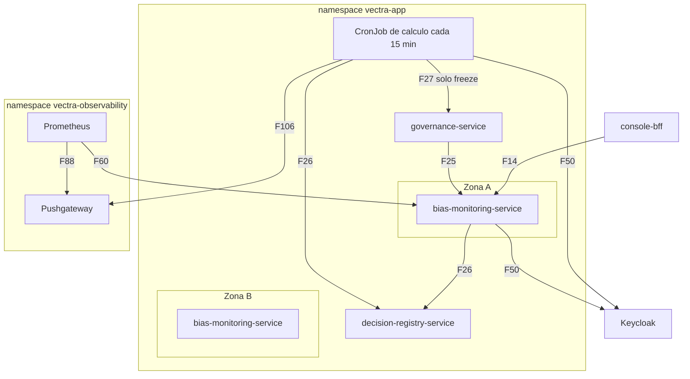

# Arquitectura de despliegue — U9 `bias-monitoring`

Vista de producción; staging y kind son iguales (el mismo chart y el mismo
`values-monitoring-policy.yaml`).

---

## 1. Topología

### Diagrama



### Alternativa en texto

```text
namespace vectra-app (pool general)
  Zona A / Zona B: bias-monitoring-service x2 (fijas), PDB minAvailable 1, vectra-normal, SA bias-monitoring-service
  CronJob de cálculo: "2,17,32,47 * * * *" UTC, Forbid, backoffLimit 0, activeDeadlineSeconds 600,
                      vectra-high, SA bias-monitoring-job, sidecar nativo de Linkerd
Entradas del servicio: console-bff (F14), governance compare_source (F25)
Salidas del servicio:  registro (F26), Keycloak (F50)
Salidas del CronJob:   registro (F26), governance solo freeze (F27), Keycloak (F50), Pushgateway (F106)
Prometheus: scrape del servicio (F60) y del Pushgateway (F88)
Sin volúmenes ni egress. Por legibilidad el diagrama muestra la zona A; la zona B es simétrica.
```

## 2. Ciclo de vida

```text
bias-monitoring-service
  arranque -> readiness OK (8081, solo el proceso) -> recibe tráfico
  terminar -> preStop sleep 5 s -> SIGTERM: uvicorn espera solicitudes (<= 10 s)
           -> terminationGracePeriodSeconds 20 s

CronJob (cada corrida)
  arranque -> token (F50) -> lectura (F26) -> cálculo -> freeze si corresponde (F27)
           -> push de los grupos run y success (F106)
           -> el contenedor termina -> el sidecar nativo termina -> Job completo o fallido
```

## 3. Inventario de recursos de Kubernetes

| Recurso | Servicio | CronJob |
|---|---|---|
| `Deployment` / `CronJob` | Deployment, 2 réplicas fijas (INF-U9-01) | CronJob (INF-U9-02) |
| `Service` | 8080 (API) y 8081 (métricas y probes) | — |
| `PodDisruptionBudget` | `minAvailable: 1` | — |
| `ServiceAccount` | `bias-monitoring-service` | `bias-monitoring-job` |
| `ExternalSecret` (llave del cliente de Keycloak) | Sí | Sí |
| `ServiceMonitor` | 8081 | — (Pushgateway) |
| Linkerd `Server`, `HTTPRoute`, `AuthorizationPolicy` | Rutas de F14 (BFF) y F25 (governance) | En governance: la ruta `freeze` solo admite `bias-monitoring-job` (INF-U9-04) |

- Una `PrometheusRule` del chart reúne las alertas de P-U9-06, todas con `severity` y `runbook_url`.
- El dashboard `bias.json` va como `ConfigMap` de dashboards de Grafana (U1).
- `Application` de Argo CD en la wave 5, con sync manual (AUTONOMIA-01).
- `NetworkPolicy` y `AuthorizationPolicy` vienen de U1 y U2, con los flujos de INF-U9-04.
