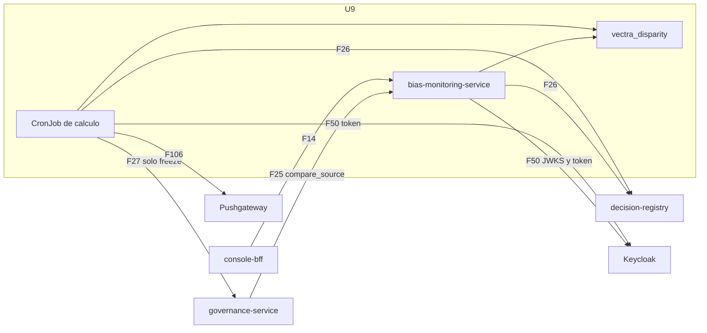

# Componentes lógicos — U9 `bias-monitoring`

---

## 1. Inventario

| Componente | Proceso | Función | Patrón | PriorityClass |
|---|---|---|---|---|
| CronJob de cálculo (`python -m vectra_bias.run`, cada 15 min) | `vectra-app` | Corrida: lectura, cálculo, congelamiento, publicación | P-U9-01, 02, 05 | `vectra-high` |
| `bias-monitoring-service` (`Deployment`, 2 réplicas fijas) | `vectra-app` | Dashboard, congelamientos, `compare_source` | P-U9-02, 03, 05 | `vectra-normal` |
| `vectra_disparity` | Librería (CronJob, servicio, U4, U5) | `counts`, `stats`, `disparity` con la supresión de celdas chicas | P-U9-04 | — |
| `freeze_rule`, `context`, `window` | CronJob | Funciones puras de la regla, el paquete y la ventana | P-U9-01 | — |
| `freeze_client` | **Solo** el CronJob | La única llamada a governance (`freeze`), con reintentos; el servicio no puede importarlo | P-U9-01, 05 | — |
| `registry_client` | Los dos | `monitoring_daily:query` y `monitoring/freezes`; sin breaker en el CronJob y con breaker en el servicio | P-U9-02 | — |
| `dashboard_cache` | Servicio | LRU de 64 entradas, 15 min, *single-flight* | P-U9-03 | — |
| `publish` | CronJob | Grupos `run` y `success` del Pushgateway | P-U9-05 | — |
| Reglas de alerta y runbooks | Repositorio GitOps | `MonitoreoSesgoDetenido`, `BiasFreezeFailed`, `DisparidadDecisionHumana`, `BiasInvalidEntries` | P-U9-06 | — |

## 2. Dependencias

### Diagrama



### Alternativa en texto

```text
console-bff   -> servicio   GET /v1/disparity, /v1/freezes, /v1/freezes/{id}        F14
governance    -> servicio   POST /v1/source-comparisons (compare_source)              F25
CronJob       -> registro   GET /v1/monitoring/freezes, POST /v1/monitoring/daily:query  F26  (sin breaker, batch)
servicio      -> registro   las mismas lecturas para el dashboard                      F26  (con breaker)
CronJob       -> governance POST /v1/models/{id}/freeze (solo freeze)                  F27
CronJob, servicio -> Keycloak  token (bias-monitoring-job / bias-monitoring-service) y JWKS   F50
CronJob       -> Pushgateway  grupos run y success (PUT)                               F106
El CronJob y el servicio usan la librería vectra_disparity; U4 y U5 también.
```

### Presupuesto de una corrida (peor caso, P-U9-02)

| Tramo | Tiempo |
|---|---|
| Token (con un reintento) | 4 s |
| Congelamientos registrados | 3 s |
| 2 solicitudes de conteos | 10 s |
| Cálculo de 3 versiones | ≤ 2 s |
| `freeze` de 3 versiones que fallan (4 intentos con 1 + 2 + 4 s de espera) | 57 s |
| Push de los dos grupos | 10 s |
| **Total** | **≈ 1,5 min ≤ 10 min (`activeDeadlineSeconds`)** |

El caso normal (sin fallos ni congelamiento) ronda unos pocos segundos, dentro del p95 de 2 min
de NFR-U9-01.

## 3. Pendiente para el Infrastructure Design de U9

- CronJob: `schedule` cada 15 min, `concurrencyPolicy: Forbid`, `backoffLimit: 0`, `activeDeadlineSeconds: 600`, `vectra-high`, sidecar nativo de Linkerd, recursos de NFR-U9-04.
- Servicio: 2 réplicas fijas con `vectra.io/hpa-exempt`, PDB, spread por zona, `vectra-normal`, readiness solo del proceso.
- Un `ExternalSecret` por cliente de Keycloak (`bias-monitoring-job` y `bias-monitoring-service`).
- Flujos F14, F25, F26, F27, F50, F60 y F106 en `flows.yaml`, con F27 solo desde el CronJob.
- `PrometheusRule` con las alertas de P-U9-06 y sus runbooks.
