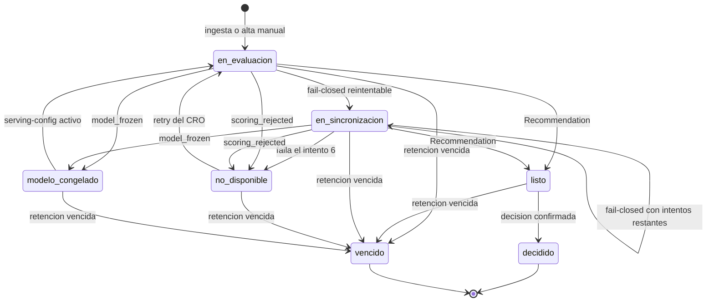

# Modelo de lógica — U8 `case-management`

## 1. Módulos lógicos

| Servicio | Módulo | Responsabilidad | Reglas |
|---|---|---|---|
| case-service | `intake` | Validación, idempotencia, escenarios de prueba, alta manual | BR-U8-01..04 |
| case-service y case-worker (precisado el 2026-10-08) | `case_fsm` | Función pura `transition(state, event) -> state \| Rechazo` | BR-U8-12 |
| case-worker (precisado el 2026-10-08, INF-U8-01) | `evaluation` | Worker de la cola: lectura de gobierno, `derive`, `ScoringRequest`, resultado | BR-U8-05..09 |
| case-service y case-worker (precisado el 2026-10-08) | `backoff` | Función pura `schedule(attempt, rng) -> delay` | BR-U8-07 |
| case-service | `sweeps` | Salida de `modelo_congelado` y marca de congelamiento posterior | BR-U8-10, 14 |
| case-service | `decision` | Validación pura (`validate_decision`) y evidencia en dos fases | BR-U8-15..18 |
| case-service | `evidence` | Outbox y reconciliador | BR-U8-09, 18, 19 |
| case-service | `views` | Proyección a `CaseSummary`/`CaseDetail` según el estado | BR-U8-13 |
| case-retention (precisado el 2026-10-08, INF-U8-01) | `retention` | Job diario de eliminación | BR-U8-20 |
| case-service | `credit` | Lectura del core con timeout; con `core.enabled = false`, `no_disponible` sin llamar (INF-U8-02) | BR-U8-21 |
| core-banking-mock | `api` | `GET` del crédito; escritura siempre rechazada | BR-U8-22 |

`case_fsm`, `backoff`, `validate_decision` y `views` son funciones puras y se prueban
con propiedades.

## 2. Máquina de estados del caso

### Diagrama



### Alternativa en texto

```text
(nuevo) -> en_evaluacion                      ingesta o alta manual (trabajo en la misma transacción)
en_evaluacion | en_sincronizacion -> listo     Recommendation (guarda registry_entry_id)
en_evaluacion | en_sincronizacion -> en_sincronizacion   fail-closed reintentable o scoring sin respuesta
en_sincronizacion -> no_disponible             falla el intento 6 (alerta + entrada fail_closed única)
en_evaluacion | en_sincronizacion -> no_disponible   scoring_rejected (4xx no reintentable; escala de inmediato)
en_evaluacion | en_sincronizacion -> modelo_congelado    FailClosed(model_frozen)
modelo_congelado -> en_evaluacion              barrido cada 5 min: serving-config activo
no_disponible -> en_evaluacion                 retry del CRO
listo -> decidido                              decisión confirmada en el registro (terminal)
en_evaluacion | listo | en_sincronizacion | no_disponible | modelo_congelado -> vencido
                                               retención vencida sin decisión (CronJob case-retention, terminal)
listo nunca vuelve a evaluarse.
```

## 3. Flujos

### 3.1 Intento de evaluación

```text
worker: toma evaluation_jobs (FOR UPDATE SKIP LOCKED, locked_until = ahora + 30 s,
        attempt = attempt + 1, cases.attempts = attempt; si el attempt leído ya es 6 -> escala sin incrementar ni llamar)
  serving-config (F104, caché <= 5 s)   falla -> last_cause serving_config_unavailable (local)
  feature-spec de esa versión (F104, caché por versión)   falla -> igual
  derive(application + identificadores, ahora, feature_spec) -> FeatureVector, MonitoringLabels
  POST /v1/recommendations (F15, timeout 7 s)
      ScoringRequest {case_id, features, monitoring_labels, policy_inputs, attempt, model_version_id}
  timeout, conexión o 5xx -> scoring_unreachable (reintentable)
  401 -> un reintento inmediato con token nuevo, dentro del mismo intento; si se repite -> scoring_rejected
  otro 4xx -> scoring_rejected: escala de inmediato (alerta ScoringRequestRejected)
  resultado -> BR-U8-08: UPDATE … WHERE state IN (en_evaluacion, en_sincronizacion) AND attempts = :attempt de esta toma
       ningún caso actualizado (vencido o cambiado) -> descartar + log evaluation.result_discarded
  intento 6 fallido o scoring_rejected -> no_disponible + evidence_outbox(fail_closed,
       cause | local_cause (exactamente uno), retryable, escalated_at)
```

### 3.2 Decisión

```text
BFF (analista) -> POST /v1/cases/{id}/decision (DecisionIn)
  validate_decision(DecisionIn, recommendation) -> 422 | ok        (BR-U8-16, BR-U0-35, BR-U0-36)
  ¿caso listo y sin otra decisión? no -> 409   (vencido, anonimizado sin decisión, también 409)
  tx: decisions(pendiente_registro) + evidence_outbox(human_decision, UUIDv5(case_id, "human_decision"))
  append F16 -> ack:    tx: confirmada + caso decidido -> 200 DecisionRef
             -> sin ack: 503; el reconciliador reintenta con la misma llave (occurred_at nuevo,
                decided_at fijo) y luego confirma; a las 24 h -> abandonada, el caso acepta otra decisión
  decisión nueva tras un abandono: misma llave -> 409 del registro si la abandonada ya estaba escrita
     -> reenviar la abandonada -> ack original -> confirmada + decidido -> 409 conflict_state (reason decision_already_recorded)
```

### 3.3 Consulta de la explicación

```text
BFF (analista) -> POST /v1/cases/{id}/explanation-views
  ¿listo o decidido? no -> 409   (vencido -> 409; decidido anonimizado -> se acepta)
  ¿existe (case_id, user_id)? sí: ¿evidencia abandonada? -> reenviar el payload original con la misma llave
                                  (ack -> confirmada) ; en todo caso -> 204
  tx: explanation_views + evidence_outbox(explanation_view, UUIDv5(case_id, user_id), viewed_at)
  append F16 (o reconciliador) -> 204
```

## 4. Propiedades testeables (PBT-01)

| ID | Componente | Propiedad | Categoría | Generadores (PBT-07) |
|---|---|---|---|---|
| PBT-U8-01 | `case_fsm` + `evaluation` | **Stateful (PBT-06)**, para toda secuencia de eventos (resultados de scoring de cada tipo, scoring sin respuesta, congelar y descongelar, `retry`, decisión con y sin ack del registro, reconciliador, abandono a las 24 h, vencimiento de la retención), contra un modelo de referencia: el estado siempre es alcanzable por BR-U8-12; `listo` nunca recibe otro intento; `decidido` y `vencido` son terminales; hay como máximo una decisión `confirmada`; un 4xx distinto de 401 escala de inmediato y nunca se reintenta; el reintento por 401 no cuenta como intento; un resultado que llega cuando el caso ya está `vencido` o cambió nunca modifica el caso; la marca `model_frozen_after_recommendation` está encendida ⇔ la versión de la recomendación figura `congelado` en el último barrido; un caso en `en_evaluacion` o `en_sincronizacion` siempre tiene exactamente un trabajo vivo; `attempts ≤ 6`; **pérdida del worker** (precisado el 2026-10-08, revisión del plan de tareas de U8): toda toma, incluida la retoma tras un arrendamiento vencido, incrementa el número; el resultado de una toma anterior nunca modifica el caso; la retoma de un trabajo con `attempt = 6` escala sin incrementar, con `local_cause = scoring_unreachable`, y el número nunca pasa de 6 | Stateful | Secuencias de 1 a 50 comandos con resultados de los 10 tipos de `cause`, `Recommendation`, fallos de transporte, 5xx, 401 y otros 4xx, resultados tardíos intercalados con el vencimiento, y reactivaciones de la versión (precisado el 2026-10-06, revisión del FD de U8); comandos `worker_lost` (vence el arrendamiento sin resultado) y `late_result` (llega el resultado de una toma anterior) (precisado el 2026-10-08) |
| PBT-U8-02 | `backoff` | Para todo intento 1..5 y toda semilla, el retraso antes del intento siguiente está en `[0,8; 1,2] · 30 s · 2^(n−1)`, y la suma de los 5 retrasos está en `[0,8 · 930 s; 1,2 · 930 s]` (≈ 15,5 min) | Invariante (cotas) | Intentos y semillas |
| PBT-U8-03 | `decision` | `validate_decision` acepta ⇔ se cumplen BR-U0-35, BR-U0-36 y BR-U8-16, contra un oráculo por tabla de verdad | Oráculo | Productos de `decision` × `outcome` de la recomendación × factores (subconjunto, ajeno, `ninguno`, vacío) × justificaciones de 0 a 2001 caracteres con espacios en los bordes |
| PBT-U8-04 | `views` | Para todo caso en un estado distinto de `listo` y `decidido`, `CaseSummary` y `CaseDetail` no contienen `score`, `outcome`, `recommendation` ni `explanation`; la bandeja nunca contiene identificadores **completos**: su única identificación es `applicant_display` (nombre + los últimos 4 dígitos del documento) (precisado el 2026-10-06, revisión del FD de U8); ninguna vista del analista contiene `sex` ni `socioeconomic_stratum`; `CaseDetail.identifiers` solo está presente si el caso no está anonimizado; un caso anonimizado no trae identificadores (precisado el 2026-10-06, revisión R1 del FD de U8) | Invariante | Casos en los 7 estados, con y sin recomendación guardada |
| PBT-U8-05 | `evaluation` | Para toda `ApplicationIn` y todo `FeatureSpec` válido, el `ScoringRequest` no contiene identificadores directos, `free_text` ni `test_scenario_id`; dos solicitudes que solo difieren en `free_text` producen el mismo `ScoringRequest` (RT-1) | Invariante | `ApplicationIn` del generador de U0 (con PII y texto libre adversarial) × `FeatureSpec` con búsquedas |
| PBT-U8-06 | `intake` | Para toda secuencia de envíos con llaves repetidas, por la ingesta (alcance `client_id`) **y por el alta manual (alcance `user_id`)**: misma llave y mismo cuerpo → el mismo `case_id`; misma llave y otro cuerpo → 409; nunca dos casos con la misma llave en el mismo alcance; la misma llave en alcances distintos no choca; tras la limpieza de 30 días la llave queda libre; `X-Test-Scenario` solo se acepta con `azp = channel-simulator` fuera de producción (precisado el 2026-10-06, revisión del FD de U8) | Idempotencia | Secuencias de envíos con llaves, cuerpos, alcances, clientes y edades repetidos |
| PBT-U8-07 | `evidence` | **Stateful (PBT-06)**, para toda secuencia de fallos y éxitos del registro (incluido un ack perdido después del commit y reintentos más de 5 min después, con un `occurred_at` nuevo en cada uno): cada evidencia termina `confirmada` exactamente una vez, o `abandonada` a las 24 h, siempre con la misma `idempotency_key`; el momento de negocio no cambia entre intentos; el registro doble tiene una sola entrada por evidencia y **nunca más de una `human_decision` por caso**, incluso con un abandono seguido de una decisión nueva cuando la abandonada sí se había escrito. Una consulta de la explicación abandonada se recupera reenviando su payload original con la misma llave, y `explanation_viewed_before` solo es `true` con la evidencia confirmada (precisado el 2026-10-06, revisión del FD de U8). **El doble implementa BR-U3-05/06 y BR-U0-37**: la ventana de ±5 min solo para llaves nuevas, la comparación de contenido sin `occurred_at` y la cota de 7 días. Así habría detectado el defecto original. El doble se valida con las pruebas de ejemplo de append de U3 (plan de U3, Paso 7), y una prueba de integración contra el registro real corre en la verificación en kind (precisado el 2026-10-06) | Stateful | Secuencias de respuestas del registro: ack, 503, timeout, ack perdido |
| PBT-U8-08 | `retention` | Después del job, ningún caso con la retención vencida conserva identificadores ni `free_text`; los no decididos quedan en `vencido` y sin trabajo; los no vencidos quedan intactos; correr el job dos veces da el mismo resultado | Invariante + idempotencia | Casos con fechas alrededor de los plazos de 2 y 10 años |

**Pruebas de ejemplo obligatorias (PBT-10):**
- solicitud válida del simulador → caso `en_evaluacion`; solicitud inválida → 4xx sin caso; un caso adversarial queda con su `test_scenario_id` (US-101);
- alta manual de un analista → canal `manual` y su `user_id`; `cumplimiento` → 403 con log de autorización (US-102);
- bandeja con casos en `listo`, `en_sincronizacion`, `no_disponible` y `modelo_congelado`; el `GET` de un caso no listo no trae `score` (US-107);
- decisión `sigue` → entrada `human_decision` con `user_id`, `model_version_id`, `policy_version_id` y `recommendation_entry_id`; decisión sobre un caso `no_disponible` → 409 sin entrada (US-108);
- con reloj simulado: recuperación en el intento 3 → `listo`; 6 fallos → `no_disponible`, gauge = 1, alerta `FailClosedPersistente` y una entrada `fail_closed` (US-112);
- primera consulta de la explicación → una entrada; segunda → 204 sin entrada (US-501);
- `se_aparta` sin factores ni `ninguno` → 422; `sigue` con `["ninguno"]` → aceptada (US-502);
- `POST` al mock con cualquier token → 403 y un `WriteAttempt` (US-603; la prueba de red en kind es de U1 y U12);
- versión pedida distinta de la de scoring → `FailClosed(version_mismatch)` y el caso reintenta (Q1);
- caso `listo` con la retención vencida → `vencido`, sin identificadores; una decisión, una consulta o un `retry` sobre él → 409 (BR-U8-12, 15, 19, 20);
- caso `decidido` anonimizado → la consulta de la explicación se acepta (BR-U8-19);
- detalle de un caso para `analista` → trae la solicitud sin `sex` ni `socioeconomic_stratum` y deja el log `case.viewed` (BR-U8-13b);
- evidencia pendiente 24 h → `abandonada`, y el caso acepta otra decisión (BR-U8-18);
- scoring responde 403 → `scoring_rejected`, el caso escala de inmediato y salta `ScoringRequestRejected`; scoring responde 401 una vez → reintento con token nuevo dentro del mismo intento (BR-U8-08);
- resultado que llega cuando el caso ya está `vencido` → el caso no cambia y queda el log `evaluation.result_discarded` (BR-U8-08);
- primer intento exitoso → `listo` con `attempts = 1` (la guarda no descarta el primer resultado) (precisado el 2026-10-08, revisión del plan de tareas de U8);
- worker perdido tras la toma → la retoma incrementa el número y el resultado tardío de la primera toma se descarta; worker perdido en el intento 6 → la retoma escala a `no_disponible` con `local_cause = scoring_unreachable` (precisado el 2026-10-08, revisión del plan de tareas de U8);
- alta manual repetida con la misma `Idempotency-Key` → el mismo caso (BR-U8-02);
- versión reactivada → el barrido apaga `model_frozen_after_recommendation` (BR-U8-14);
- decisión abandonada que el registro sí había escrito + decisión nueva → 409 `conflict_state` con `reason = decision_already_recorded`; el caso queda `decidido` con la primera y el registro tiene una sola `human_decision` (BR-U8-18).

## 5. Cumplimiento de extensiones (Functional Design U8)

Revisada contra el cuerpo de los tres artefactos antes de presentarla.

| Regla | Estado | Evidencia |
|---|---|---|
| AUTONOMIA-03 | Cumple | BR-U8-21, 22: solo lectura del core; la escritura del mock existe solo para RT-5 y siempre se rechaza |
| AUTONOMIA-05 | Cumple | BR-U8-06 y PBT-U8-05: ni identificadores ni `free_text` salen hacia scoring; F104 y F17 son internos al clúster. BR-U8-20: la eliminación de identificadores se vuelve a aplicar después de cada restauración (R2) |
| AUTONOMIA-06 | Cumple | BR-U8-08, 12, 13: un caso solo es `listo` con una `Recommendation` registrada; los fail-closed nunca muestran un score; BR-U8-05 impide puntuar un vector con otra versión |
| SECURITY-03 | Cumple | BR-U8-03, 19: `test_scenario_id` fuera de los logs de negocio; eventos sin PII del solicitante; BR-U8-13b: log `case.viewed` de cada acceso al detalle, sin datos del solicitante (R1) |
| SECURITY-05 | Cumple | BR-U8-01, 02, 16 (validación de entradas y de la decisión) |
| SECURITY-08 | Cumple | BR-U8-04, 11, 15, 19 (rol por operación y reglas de objeto: estado del caso, decisión a nombre del llamante); BR-U8-13b (qué datos ve cada rol: sin etiquetas de monitoreo para el analista; R1) |
| SECURITY-11 | Cumple | Casos de abuso con prueba: escritura al core (BR-U8-22, RT-5), conjunto adversarial y cabecera de escenario en producción (BR-U8-03), llave de idempotencia reutilizada con otro cuerpo (BR-U8-02, PBT-U8-06), `free_text` adversarial (PBT-U8-05, RT-1) |
| SECURITY-13 | Cumple | BR-U8-18 y PBT-U8-07: la decisión solo vale si quedó en el registro, con una sola entrada por evidencia; `recommendation_entry_id` liga la decisión con la recomendación entregada (P-U7-03) |
| SECURITY-14 | Cumple | BR-U8-09 (gauge `vectra_cases_failclosed_persistent` → alerta `FailClosedPersistente`), BR-U8-04 y BR-U8-15 (denegaciones con log `authz.denied` y la métrica de BR-U0-73), BR-U8-22 (cada intento de escritura al core queda como `WriteAttempt`), BR-U8-11 (`case.retry_requested` con el usuario). Las reglas de alerta concretas se fijan en NFR Design (precisado el 2026-10-06) |
| SECURITY-15 | Cumple | BR-U8-08 (todo fallo de scoring es reintentable y nunca un score), BR-U8-21 (el core caído no rompe la vista), 503 con la decisión pendiente (BR-U8-18) |
| PBT-01 | Cumple | §4 |
| PBT-06 | Cumple | PBT-U8-01 y PBT-U8-07 (stateful) |
| PBT-07 | Cumple | Columna «Generadores» de §4 |
| PBT-10 | Cumple | Pruebas de ejemplo de §4, una o más por historia |
