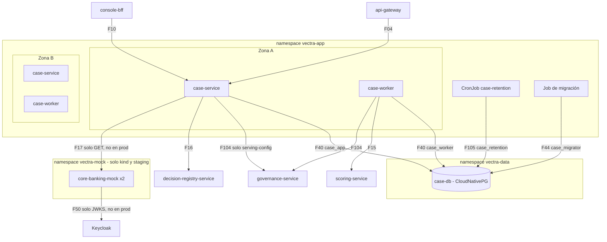

# Arquitectura de despliegue — U8 `case-management`

Vista de staging. Producción es igual **sin** el namespace `vectra-mock` y **sin** F17 ni
F50 del mock: con `core.enabled = false`, `case-service` no llama al core y responde
`credit_status = no_integrado` (INF-U8-02, aclaración Q1 = A; precisado el 2026-10-10 por U10 FD, Q3). kind usa 2 réplicas fijas y
también incluye el mock.

---

## 1. Topología

### Diagrama



### Alternativa en texto

```text
namespace vectra-app (pool general)
  Zona A / Zona B:
    case-service  2..6 (HPA CPU 70 %), PDB minAvailable 1, vectra-high, SA case-service
    case-worker   2..6 (HPA CPU 70 %), PDB minAvailable 1, vectra-high, SA case-worker
  CronJob case-retention   diario 02:30 America/Bogota, Forbid, vectra-low, SA case-retention
  Job de migración          hook de sync de Argo CD, vectra-low, rol case_migrator
namespace vectra-data:  case-db (CloudNativePG, 50 Gi, max_connections 100)
namespace vectra-mock:  core-banking-mock x2, vectra-low  (solo kind y staging)

Entradas de case-service:  api-gateway (F04), console-bff (F10)
Salidas de case-service:   case-db como case_app (F40), registro (F16),
                           governance solo serving-config (F104), core-mock solo GET (F17,
                           solo kind y staging; en producción core.enabled = false y sin llamada)
Salidas de case-worker:    case-db como case_worker (F40), scoring (F15),
                           governance serving-config y feature-spec (F104)
case-retention:            case-db como case_retention (F105)
core-banking-mock:         Keycloak, solo JWKS (F50); solo kind y staging
Prometheus scrapea el puerto 8081 de case-service y case-worker, y del mock en kind y
staging (F60).
Cada pod: sidecar nativo de Linkerd (mTLS); sin volúmenes; egress solo a lo listado.
Por legibilidad el diagrama muestra la zona A; la zona B es simétrica.
```

## 2. Ciclo de vida

```text
case-service
  arranque  -> conexión a case-db -> readiness OK (8081) -> recibe tráfico
  terminar  -> preStop sleep 5 s -> SIGTERM: uvicorn espera solicitudes (<= 10 s);
               barridos y reconciliador dejan de tomar trabajo
            -> terminationGracePeriodSeconds 20 s

case-worker
  arranque  -> conexión a case-db -> readiness OK -> empieza a sondear la cola
  terminar  -> SIGTERM: deja de sondear; espera las llamadas en vuelo (<= 20 s)
            -> terminationGracePeriodSeconds 30 s (peor caso de una llamada: 15,5 s)
            -> lo no terminado se retoma al vencer locked_until (30 s)

case-retention (cada corrida)
  arranque  -> lee retention_settings -> lotes de 500 -> fila en retention_runs
            -> el contenedor termina -> el sidecar nativo de Linkerd termina -> Job completo
```

## 3. Inventario de recursos de Kubernetes

| Recurso | `case-service` | `case-worker` | `case-retention` | `core-banking-mock` |
|---|---|---|---|---|
| `Deployment` / `CronJob` | Deployment (INF-U8-04, 06) | Deployment (INF-U8-04, 06) | CronJob (P-U8-07) | Deployment (INF-U8-02) |
| `Service` | 8080 (API) y 8081 (métricas y probes) | 8081 | — | 8080 y 8081 |
| `HorizontalPodAutoscaler` | 2–6, CPU 70 % | 2–6, CPU 70 % | — | — |
| `PodDisruptionBudget` | `minAvailable: 1` | `minAvailable: 1` | — | `minAvailable: 1` |
| `ServiceAccount` | `case-service` | `case-worker` | `case-retention` | `core-banking-mock` |
| `ExternalSecret` (llave del cliente de Keycloak) | Sí | Sí | — | — |
| `Secret` del rol de base (CloudNativePG) | `case_app` | `case_worker` | `case_retention` | — |
| `ServiceMonitor` | 8081 | 8081 | — | 8081 |
| Linkerd `Server`, `HTTPRoute`, `AuthorizationPolicy` | U2 | U2 | — | `GET /v1/credits/{id}` solo desde `case-service`, más la ruta de captura sin autorización (INF-U8-03) |

- Una `PrometheusRule` del chart reúne las alertas de P-U8-04, 06, 07, 08 e INF-U8-03, todas con `severity` y `runbook_url`. `CoreWriteAttempt` solo se renderiza con `coreMock.enabled = true`. El volumen de `case-db` lo vigila `PostgresVolumeUsageHigh` de U1 (INF-U8-08).
- El Job de migración usa el rol `case_migrator` y escribe la fila de `retention_settings` desde los values (P-U8-05).
- `Application` de Argo CD con sync manual (AUTONOMIA-01).
- `NetworkPolicy` y `AuthorizationPolicy` vienen de U1 y U2, con los cambios de flujos de INF-U8-01 y 02.
