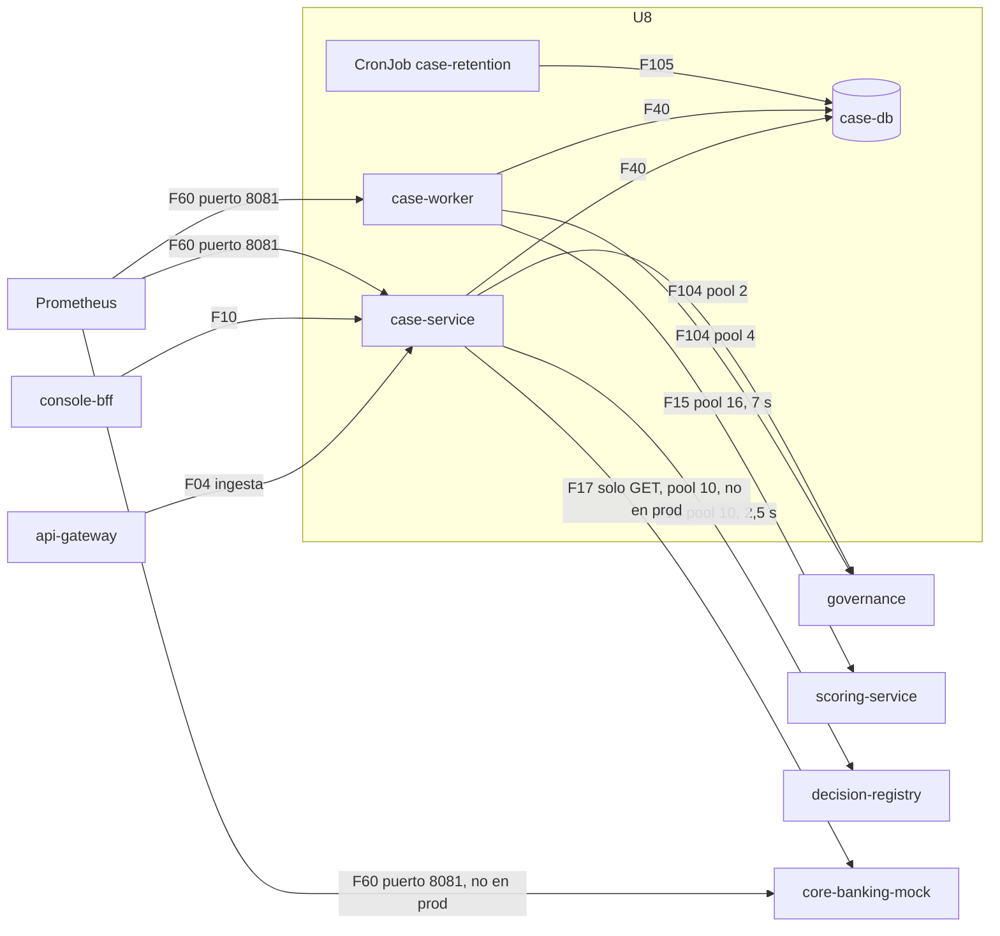

# Componentes lógicos — U8 `case-management`

---

## 1. Inventario

| Componente | Proceso | Función | Patrón | PriorityClass |
|---|---|---|---|---|
| `case-service` (`Deployment`, 2–6) | `vectra-app` | API, barridos de BR-U8-10/14, reconciliador de evidencia, métricas calculadas de la base | P-U8-03, 04, 07, 08, 10 | `vectra-high` |
| `case-worker` (`Deployment`, 2–6; identidad propia, INF-U8-01) | `vectra-app` | Evaluación: toma de la cola, llamadas a governance y scoring, aplicación del resultado | P-U8-01, 02, 10 | `vectra-high` |
| `case-retention` (`CronJob`, diario) | `vectra-app` | Eliminación de identificadores y paso a `vencido`; limpieza de `intake_keys` | P-U8-05, 07 | `vectra-low` (INF-U8-04) |
| Job de migración | `vectra-app` | DDL; tabla `case_transitions` con sus filas y trigger `guard_transition` (INF-U8-01); trigger `guard_vencido`; políticas RLS de `evidence_outbox` (INF-U8-01); fila de `retention_settings` desde los values | P-U8-05; INF-U8-01 | `vectra-low` (INF-U8-04) |
| `core-banking-mock` (`Deployment`, 2; solo kind y staging) | `vectra-mock` | `GET /v1/credits/{id}`; `WriteAttempt` para RT-5 | P-U8-06 | `vectra-low` |
| `job_queue` | `case-worker` | Toma con `SKIP LOCKED` y arrendamiento de 30 s; semáforo de 16 | P-U8-01 | — |
| Clientes por dependencia (`httpx` + `deps.call`) | ambos | Un pool, un timeout y un circuit breaker por dependencia | P-U8-02 | — |
| `serving_config_client`, `feature_spec_cache` | `case-worker` (`case-service` solo usa `serving_config_client` en el barrido) | Caché ≤ 5 s con `etag`; LRU de 4 versiones | NFR-U8-15 | — |
| `reconciler` | `case-service` | Reintentos del outbox (1 s a 5 min), con a lo sumo 4 envíos en vuelo, y abandono a las 24 h | P-U8-02, 04 | — |
| `db_gauges` | `case-service` | Cada 30–60 s: cola atrasada, evidencia pendiente, retención, `no_disponible` | P-U8-04, 07, 08 | — |
| `case_fsm`, `backoff` | `case-service` y `case-worker` | Funciones puras del FD | — | — |
| `decision`, `views`, `intake` | `case-service` | Funciones del FD | — | — |
| `evaluation` | `case-worker` | Funciones del FD | — | — |
| `metrics` | todos | Métricas en el puerto 8081 (F60) | P-U8-06, 08 | — |
| Reglas de alerta y runbooks | Repositorio GitOps | P-U8-04, 06, 07, 08 | P-U8-08 | — |

### Tablas de `case-db` y roles

| Tabla | `case_app` | `case_worker` (INF-U8-01) | `case_retention` | `case_migrator` |
|---|---|---|---|---|
| `cases` | `SELECT`, `INSERT` (solo en `en_evaluacion` y sin recomendación), `UPDATE (state, attempts, model_frozen_after_recommendation, updated_at)` | `SELECT`, `UPDATE` de las columnas de evaluación (nunca `vencido`) | `SELECT`, `UPDATE (application, anonymized_at, state)` (solo `vencido`, `guard_vencido`) | DDL |
| `case_identifiers` | `SELECT`, `INSERT`, `UPDATE` | `SELECT` | `SELECT (case_id)`, `DELETE` | DDL |
| `evaluation_jobs` | `SELECT`, `INSERT` | `SELECT`, `UPDATE`, `DELETE` | `SELECT (case_id)`, `DELETE` | DDL |
| `intake_keys` | `SELECT`, `INSERT` | — | `SELECT (created_at)`, `DELETE` | DDL |
| `decisions` | `SELECT`, `INSERT`, `UPDATE` | — | `SELECT (case_id, decided_at, state)` (plazo de 10 años desde la decisión confirmada) | DDL |
| `explanation_views`, `evidence_outbox` | `SELECT`, `INSERT`, `UPDATE` (política RLS `app_all` en `evidence_outbox`) | `INSERT` en `evidence_outbox`, **solo `fail_closed`** por la política RLS `worker_fail_closed_only` (`WITH CHECK (entry_type = 'fail_closed')`, INF-U8-01) | — | DDL; dueño, RLS no le aplica |
| `retention_runs` | `SELECT` | — | `INSERT` | DDL |
| `retention_settings` | `SELECT` | — | `SELECT` | DDL y la fila (desde los values) |
| `case_transitions` | — | — | — | DDL y las filas; la lee solo el trigger `guard_transition` (`SECURITY DEFINER`, INF-U8-01) |

## 2. Dependencias

### Diagrama



### Alternativa en texto

```text
api-gateway   -> case-service    POST /v1/intake/applications                    F04
console-bff   -> case-service    bandeja, detalle, alta, decision, explicacion   F10
case-service  -> case-db         API, barridos, reconciliador, metricas          F40  pool 5
case-worker   -> case-db         toma y aplicacion (transacciones cortas)        F40  pool 5
case-retention-> case-db         lotes de 500, SKIP LOCKED, rol case_retention   F105
case-worker   -> governance      serving-config (cache 5 s) y feature_spec       F104 pool 4
case-service  -> governance      barrido de modelo_congelado cada 5 min          F104 pool 2
case-worker   -> scoring         POST /v1/recommendations, timeout 7 s           F15  pool 16
case-service  -> registro        human_decision, explanation_view, fail_closed   F16  pool 10
case-service  -> core-mock       solo GET /v1/credits/{id}, timeout 500 ms       F17  pool 10
              (solo kind y staging; en produccion core.enabled = false, sin llamada)
Prometheus    -> case-service, case-worker              GET /metrics :8081       F60
Prometheus    -> core-mock (solo kind y staging)        GET /metrics :8081       F60
Cada pool tiene su propio circuit breaker (vectra_common.deps).
```

### Presupuesto de la evaluación (p95, primer intento, cachés calientes)

| Tramo | p95 |
|---|---|
| Espera en la cola (sondeo de 400 ms ± 100 ms) | ≤ 500 ms |
| Toma (transacción corta) | ~10 ms |
| `serving-config` y `feature_spec` (caché) | ~0 ms |
| `derive` | ≤ 5 ms (NFR-U0) |
| scoring (U7, NFR-U7-01) | ≤ 400 ms |
| Aplicación del resultado | ~10 ms |
| **Total** | **≈ 0,95 s ≤ 5 s (NFR-U8-02)** |

El margen cubre una caché de `feature_spec` fría (≤ 1 s) y la cola con carga.

Toda transición de `state` pasa además por `guard_transition`, que comprueba el par de estados y el rol contra `case_transitions` (INF-U8-01).

En PostgreSQL, un `DELETE … WHERE` exige `SELECT` sobre las columnas que lee. Por eso `case_retention` tiene `SELECT` por columna en cada tabla de la que borra, y en `decisions` para calcular el plazo (hallazgo 1 de la revisión). La prueba de P-U8-07 corre con el rol real.

## 3. Pendiente para el Infrastructure Design de U8

**Todos resueltos el 2026-10-08 por el Infrastructure Design de U8**: recursos (INF-U8-04, 05), flujos y políticas (INF-U8-01, 02, 03), values (INF-U8-07), alertas (INF-U8-03, 08 y `deployment-architecture.md` §3) e identidad (INF-U8-01).

- ~~Recursos (requests y limits) de `case-service`, `case-worker`, `case-retention` y el mock, y su relación con el HPA al 70 %.~~ → INF-U8-04, 05.
- ~~Confirmar que F04, F10, F15–F17, F40, F44, F60, F104 y F105 ya existen en las `NetworkPolicy` y `AuthorizationPolicy` de U1 y U2, incluido el puerto 8081 del mock solo para Prometheus (X01).~~ → INF-U8-01, 02, 03 y `component-dependency.md` §2 y X01.
- ~~Values de retención (`retention.*`) y de horario del CronJob por entorno; `allow_test_scenarios = false` en producción.~~ → INF-U8-07.
- ~~Empaquetado de las reglas de alerta de P-U8-04, 06, 07 y 08 y sus runbooks.~~ → `deployment-architecture.md` §3.
- ~~**Identidad de `case-worker`**: fijar si `case-service` y `case-worker` comparten ServiceAccount (identidad de Linkerd) y cliente de Keycloak, o si `case-worker` tiene los suyos (hallazgo 7 de la revisión).~~ → INF-U8-01: `case-worker` tiene identidad propia en las tres capas (ServiceAccount, cliente de Keycloak `case-worker` y rol `case_worker`), y es origen de F15, F40 y F104 en las `NetworkPolicy`, las `AuthorizationPolicy` y el realm de U2.
