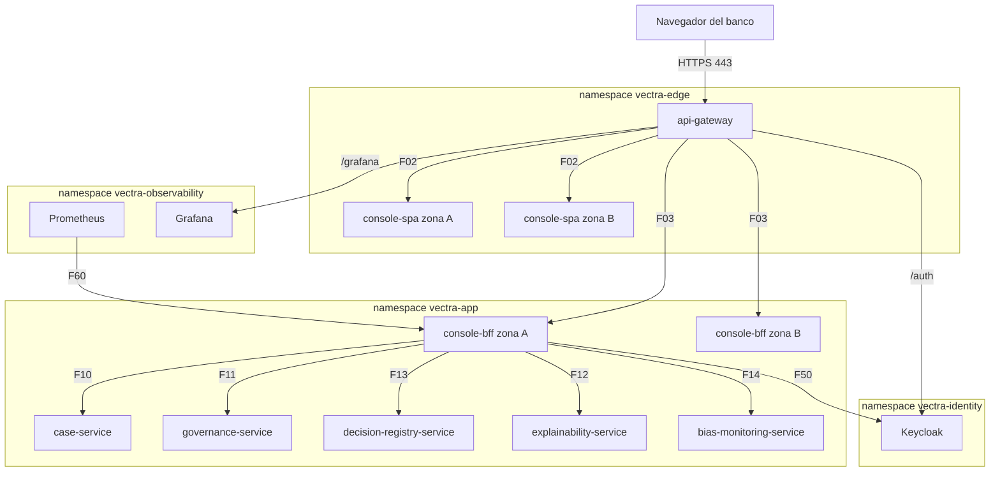

# Arquitectura de despliegue — U10 `console`

Vista de producción. Staging es igual; kind fija el HPA del BFF en 2 réplicas (`minReplicas = maxReplicas = 2`)
y usa el realm `kind` con usuarios de prueba (INF-U10-06).

---

## 1. Topología

### Diagrama



### Alternativa en texto

```text
Navegador -> api-gateway (vectra-edge, 443)
  /           -> console-spa x2 (vectra-edge; zonas A y B; nginx-unprivileged; vectra-normal)   F02
  /api/console -> console-bff (vectra-app; HPA 2..6; zonas A y B; vectra-high)                  F03
  /auth       -> Keycloak (vectra-identity)
  /grafana    -> Grafana (vectra-observability; iframe del dashboard de sesgo)
console-bff -> case (F10), governance (F11), explainability (F12), registry (F13), bias (F14), JWKS (F50)
Prometheus -> console-bff:8081 (F60)
Todo en la malla de Linkerd; sin volúmenes persistentes ni egress.
Por legibilidad el diagrama muestra las salidas de la zona A; la zona B es simétrica.
```

## 2. Ciclo de vida

```text
console-bff
  arranque -> carga el registro de rutas (falla si una ruta no tiene object_rule)
           -> readiness OK (8081, solo el proceso) -> recibe tráfico
  terminar -> preStop 5 s -> SIGTERM: uvicorn espera solicitudes (<= 10 s)
           -> terminationGracePeriodSeconds 20 s

console-spa
  arranque -> nginx con config.json (ConfigMap) y version.json (imagen) -> /healthz OK
  despliegue -> la imagen nueva trae los recursos de N y de N-1 (INF-U10-02)
             -> las pestañas abiertas siguen cargando; version.json cambia -> aviso
```

## 3. Inventario de recursos de Kubernetes

| Recurso | `console-bff` | `console-spa` |
|---|---|---|
| `Deployment` | Sí (INF-U10-01) | Sí, 2 réplicas fijas |
| `HorizontalPodAutoscaler` | 2 a 6 por CPU | — (`vectra.io/hpa-exempt`) |
| `Service` | 8080 (API) y 8081 (métricas y probes) | 8080 |
| `PodDisruptionBudget` | `minAvailable: 1` | `minAvailable: 1` |
| `ServiceAccount` | `console-bff` | `console-spa` |
| `ConfigMap` | URLs y audiencias de los destinos por entorno. Los timeouts y los límites de conexiones de P-U10-04 son **constantes del código** (`console_bff/config.py`), con una prueba que los compara con la tabla de P-U10-04; no son values, como en U8 y U9 (segunda revisión del Infrastructure Design de U10, 2026-10-10) | `config.json` (INF-U10-03) |
| `ExternalSecret` | Ninguno: el BFF usa el token del usuario y no tiene cliente de servicio | Ninguno |
| `ServiceMonitor` | 8081 | — |
| `PrometheusRule` | Alertas y recording rules de P-U10-10 | — |
| Dashboard (`ConfigMap` de Grafana) | `console.json` | — |
| Linkerd `Server`, `AuthorizationPolicy` | 8080 (gateway) y 8081 (Prometheus) | 8080 (gateway) |
| `HTTPRoute` del gateway | `/api/console/**` (U2) | `/` y estáticos (U2) |

- `Application` de Argo CD en la wave 5, una por componente, sin auto-sync (AUTONOMIA-01).
- `NetworkPolicy` y `AuthorizationPolicy` vienen de U1, desde `flows.yaml` (INF-U10-04).
