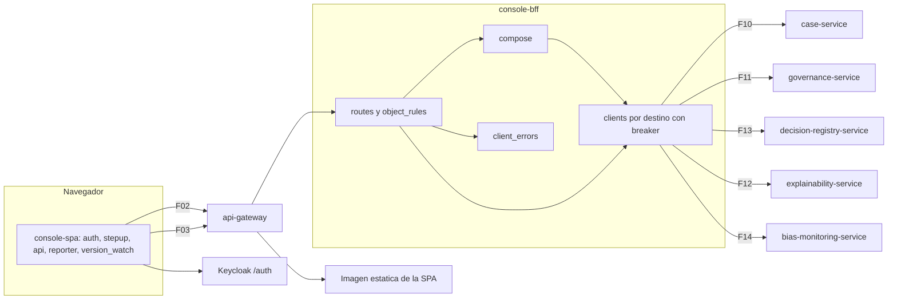

# Componentes lógicos — U10 `console`

## 1. Componentes

| Componente | Proceso | Responsabilidad | Patrones | Estado |
|---|---|---|---|---|
| `routes` | `console-bff` | Los 29 `RouteContract` de C03 con rol, MFA y regla de objeto | P-U10-01 | — |
| `object_rules` | `console-bff` | Funciones puras de autorización por objeto | P-U10-01 | — |
| `compose` | `console-bff` | `get_dossier` (en paralelo) y `get_disparity` (en serie, sin caché) | P-U10-02 | — |
| `clients` | `console-bff` | Un cliente de `deps.call` por destino con timeout, presupuesto, límite de conexiones y circuit breaker | P-U10-03, 04 | **Por proceso**: 5 circuit breakers |
| `errors` | `console-bff` | Traducción al `Problem` de U0 | P-U10-03 | — |
| `client_errors` | `console-bff` | Validación de `ClientErrorReport`, evento y métrica | P-U10-09 | — |
| `metrics` | `console-bff` | Histogramas por ruta y por destino; contadores de errores | P-U10-10, 11 | — |
| `auth` | `console-spa` | `oidc-client-ts` en memoria; inactividad; logout entre pestañas | P-U10-07 | Memoria |
| `stepup` | `console-spa` | `OidcClient.createSigninRequest` → `window.open` en el clic → `postMessage` desde `/stepup-callback` → validación de origen, ventana y `state` → `OidcClient.processSigninResponse` → reintento único (segunda revisión del Infrastructure Design de U10, 2026-10-10) | P-U10-07; BR-U10-06 | Memoria |
| `api` | `console-spa` | Cliente `openapi-fetch` de U0 con timeout de 10 s y TanStack Query | P-U10-04 | Caché en memoria |
| `version_watch` | `console-spa` | Consulta de `version.json` cada 5 min y aviso | P-U10-06 | — |
| `reporter` | `console-spa` | Captura de errores y envío limitado | P-U10-09 | Contador por minuto |
| `views` | `console-spa` | Vistas y componentes de `frontend-components.md` | FD | — |
| Imagen estática | `console-spa` | `nginx-unprivileged` con los recursos de la versión actual y la anterior, `version.json` y cabeceras de caché | P-U10-06; NFR-U10-45 | — |

## 2. Diagrama



### Alternativa en texto

```text
Navegador: console-spa (auth, stepup, api, reporter, version_watch)
  F02 -> api-gateway -> imagen estática (versión actual + anterior, version.json)
  F03 -> api-gateway -> console-bff
  /auth -> Keycloak (login, refresh, step-up en ventana emergente)
console-bff: routes + object_rules -> compose -> clients (uno por destino, con breaker)
  F10 case-service | F11 governance | F12 explainability | F13 registry | F14 bias
  client_errors: evento console.client_error y métrica
```

## 3. Estado

- El BFF solo tiene estado por proceso en los 5 circuit breakers. No guarda sesiones ni datos, y no hay afinidad de sesión.
- La SPA guarda todo en memoria: tokens, caché de vistas, borradores y el estado del step-up. Los filtros de la bandeja viven en la URL (BR-U10-10).
