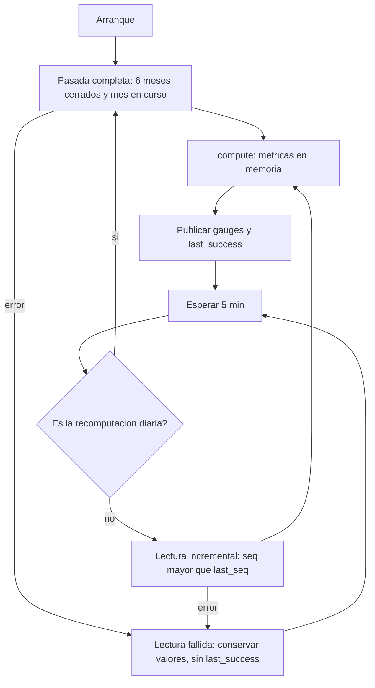

# Modelo de lógica — U11 `product-metrics`

## 1. Módulos lógicos

| Módulo | Responsabilidad | Reglas |
|---|---|---|
| `reader` | Lectura completa y por `seq` de la proyección `metrics` (F28), con paginación | BR-U11-11 |
| `state` | Entradas en memoria, `last_seq`, descarte de las de más de 35 días | BR-U11-11 |
| `compute` | Función pura `compute(entries, params, now) -> BusinessMetrics` | BR-U11-01..10 |
| `noise` | Función pura `days_below_floor(daily_windows, F, N)` | BR-U11-07 |
| `publish` | Gauges en `/metrics` con la allowlist de etiquetas | domain-entities §5 |
| `rules` | Recording y alerting rules, incluidas las de BR-U11-06 | BR-U11-06, 14 |
| `dashboard` | `product.json` con targets como líneas de referencia | BR-U11-12 |

`compute` y `noise` no hacen E/S y se prueban con propiedades.

## 2. Flujos

### 2.1 Ciclo del servicio



### Alternativa en texto

```text
arranque -> pasada completa (desde el día 1 del sexto mes cerrado − 1 d, por seq, bajo el candado) -> compute -> publicar
cada 5 min:
  ¿02:30 UTC + desfase y sin recomputación hoy? sí -> pasada completa, reemplazo del estado y lectura incremental
                                               desde su last_seq, todo bajo el candado
  ¿candado tomado? sí -> omitir el ciclo (cycles_skipped += 1)
                   no -> lectura de seq > last_seq
  -> descartar decided_at < now - 35 d -> compute -> publicar (con last_success)
  error de lectura -> conservar los valores; last_success no avanza; ProductMetricsStale a los 30 min
```

### 2.2 `compute`

```text
para cada human_decision válida (BR-U11-10: catálogo, actor_role = analista, decided_at ≤ recorded_at + 5 min;
  si no, invalid_entries += 1):
  recommendation = decisión.recommendation (resuelta por U3)
  si recommendation es null -> unattributable_decisions[día(decided_at)] += 1; siguiente
  día = día UTC(decided_at)
  denominador[día, cortes] += 1
  si explanation_viewed_before y used_factors != ["ninguno"]:
      numerador_north_star[día, cortes] += 1; desglose[decision] += 1
  si decision == sigue: sostenidas[día, cortes] += 1
  si explanation_viewed_before: vistas[día] += 1
  si channel != manual y outcome != revision_requerida y first_evaluation:
      origination[día(evaluated_at)].append(evaluated_at - received_at)
agregar por periodo de BR-U11-08 (day = ayer completo; 30d hasta ayer; month_to_date hasta ayer; month = mes anterior cerrado),
  publicando conteos con todos los cortes y razones solo totales o por un corte (BR-U11-08); un denominador 0 no publica tasa
ventanas de 7 días para la tasa de consulta; noise.days_below_floor(...)
degraded = invalid_entries / total > 0,01
```

### 2.3 `days_below_floor`

```text
contar hacia atrás desde ayer:
  ventana de 7 días que termina el día d:
    decisiones < N -> no suma ni reinicia; seguir con d - 1
    tasa < F       -> cuenta += 1; seguir
    tasa >= F      -> parar
resultado = cuenta
```

## 3. Propiedades testeables (PBT-01)

| ID | Componente | Propiedad | Categoría | Generadores (PBT-07) |
|---|---|---|---|---|
| PBT-U11-01 | `compute` | Para todo conjunto de decisiones, cada tasa está en [0, 1], numerador ≤ denominador, y los conteos coinciden con un oráculo que cuenta por definición (BR-U11-03, 04, 07); una decisión no atribuible nunca entra en un cociente | Oráculo / invariante | Decisiones con todas las combinaciones de `decision`, `used_factors`, `explanation_viewed_before`, `channel`, `outcome`, `attempt` y referencias válidas o nulas |
| PBT-U11-02 | `state` + `compute` | Para toda secuencia de entradas partida en lotes arbitrarios por `seq`, el resultado de aplicar los lotes de forma incremental es igual al de una recomputación completa sobre la unión (ajuste 1 de Q6), también con recomputaciones completas **intercaladas** con ciclos incrementales (que se omiten mientras la pasada lee), fallos a mitad de la pasada y la lectura incremental posterior desde el `last_seq` de la pasada; y nunca hay dos lecturas a U3 a la vez (P-U11-02; revisión del NFR Design de U11, 2026-10-10) | Equivalencia (stateful) | Secuencias de entradas y particiones en lotes; avances del reloj que descartan entradas viejas |
| PBT-U11-03 | `compute` | El resultado no depende del orden de llegada ni de `recorded_at`: solo de los momentos de negocio; leer dos veces la misma entrada (mismo `seq`) no cambia nada | Invariante | Permutaciones y duplicados de entradas, con `recorded_at` hasta 24 h después del momento de negocio |
| PBT-U11-04 | `noise` | `days_below_floor` coincide con un oráculo que recorre los días; un día con menos de N decisiones no suma ni reinicia; la cuenta nunca supera los días con muestra | Oráculo | Series diarias de vistas y decisiones, con días sin muestra |
| PBT-U11-05 | `publish` | Para toda salida de `compute`, toda serie publicada usa solo etiquetas de la allowlist y ningún valor de etiqueta es un `case_id`, un `seq` ni un identificador de usuario | Invariante | Salidas de `compute` con cortes generados |
| PBT-U11-06 | `compute` | El tiempo de originación solo incluye casos estándar (BR-U11-05) y sus cuantiles coinciden con un oráculo; un caso con `first_evaluation = false`, `manual` o `revision_requerida` nunca entra, aunque tenga `attempt = 1` | Oráculo | Recomendaciones entregadas con todos los canales, resultados, intentos y `first_evaluation` |
| PBT-U11-07 | `compute` + `publish` | Para toda partición de las decisiones por cortes, la suma de los conteos publicados por corte es igual al conteo del total `all`, y la razón total es `sum(numerador) / sum(denominador)` (revisión del FD de U11, 2026-10-10) | Invariante | Decisiones con cortes generados |

**Pruebas de ejemplo obligatorias (PBT-10):**
- 10 decisiones: 4 con explicación vista y factores (2 `sigue`, 1 `se_aparta`, 1 `resuelve_revision`), 3 vistas con `["ninguno"]`, 3 sin vista → North Star 0,4 con el desglose 2, 1, 1 (US-503);
- un día sin decisiones → sin tasa publicada para ese día (no 0);
- tasa de consulta de 0,5 con N = 50 durante 3 días seguidos y F = 0,6 → `days_below_floor = 3` y `RuidoExplicacion` dispara con S = 3 (US-504, con `promtool test rules`);
- los mismos 3 días con 40 decisiones cada uno → la cuenta no suma y la alerta no dispara;
- reinicio del proceso a mitad → `days_below_floor` igual que antes del reinicio;
- una decisión sobre una recomendación de hace 60 días (fuera de la ventana de lectura) → atribuible, porque U3 la resuelve; una decisión que referencia una entrada `freeze` → no atribuible;
- un caso `manual`, con `attempt = 2` o descongelado con `attempt = 1` y `first_evaluation = false` → fuera del tiempo de originación (revisión del FD de U11, 2026-10-10);
- `day` publicado a las 10:00 UTC no incluye las decisiones de hoy; el 1 del mes no se publica `month_to_date` y `month` es el mes anterior completo;
- una decisión con `decided_at` 3 min después de `recorded_at` → válida; 10 min después → excluida; una con `actor_role = cro` → excluida;
- `gen_rules.py --check` falla si se agrega una causa `desincronia` al catálogo de U0 sin regenerar la regla;
- una entrada con `decision` desconocido → excluida, con `invalid_entries = 1` y su `seq` solo en el log;
- 2 % de entradas inválidas → `degraded = 1`;
- registro caído 31 min → `ProductMetricsStale`;
- `/metrics` no tiene ninguna etiqueta fuera de la allowlist (US-505);
- `vectra:product_complete_response_ratio:1h` con 98 `recommendation` y 2 `fail_closed` → 0,98 (`promtool test rules`, US-505);
- dashboard: la nota de aproximación de BR-U11-04 está, los targets se dibujan, el de la North Star dice «sin target acordado» y `forbidden_phrases.py` pasa.

## 4. Cumplimiento de extensiones (Functional Design U11)

| Regla | Estado | Evidencia |
|---|---|---|
| AUTONOMIA-05 | Cumple | Sin egress: lee el registro (F28) y publica para Prometheus (F60) |
| SECURITY-03 | Cumple | BR-U11-08, 10 (sin datos por persona; `seq` solo en el log); PBT-U11-05 |
| SECURITY-08 | Cumple | BR-U11-13 (permisos de carpeta por equipo, sin herencia de rol) |
| RESILIENCY-05 / 07 / 15 | Cumple | BR-U11-14 (alertas con runbook) |
| RESILIENCY-10 | Cumple | BR-U11-11 (lectura fallida conserva valores; alerta de obsolescencia) |
| PBT-01 | Cumple | §3 |
| PBT-06 | Cumple | PBT-U11-02 (equivalencia incremental frente a completa) |
| PBT-07 | Cumple | Columna «Generadores» de §3 |
| PBT-10 | Cumple | Pruebas de ejemplo de §3 |
