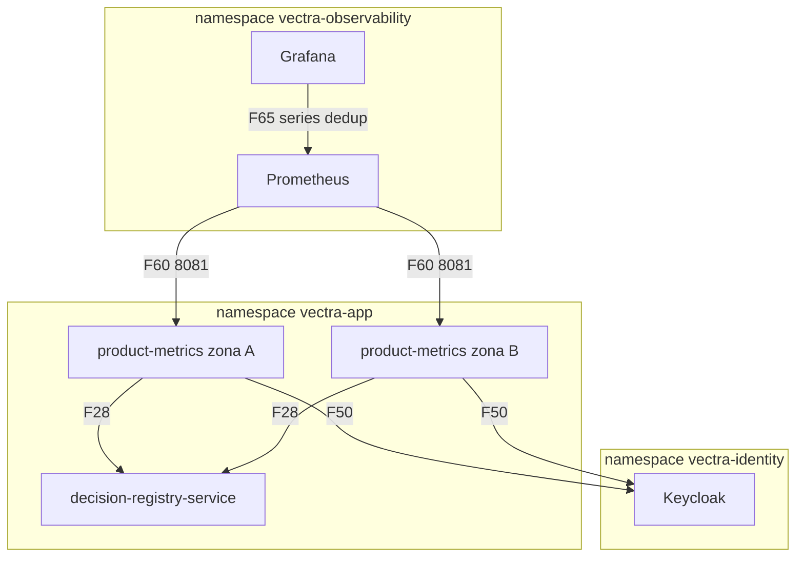

# Arquitectura de despliegue — U11 `product-metrics`

Vista de producción. Staging y kind son iguales (mismo chart y mismo archivo de parámetros).

---

## 1. Topología

### Diagrama



### Alternativa en texto

```text
namespace vectra-app
  product-metrics x2 (zonas A y B; fijas, hpa-exempt; vectra-normal; SA sin token montado)
    -> decision-registry-service (F28, una página a la vez por réplica)
    -> Keycloak (F50, token del cliente product-metrics)
Prometheus -> 8081 de cada réplica (F60); recording rules :dedup
Grafana -> Prometheus (F65): product.json en Vectra / Producto; panel de operación en la carpeta de operación
Sin volúmenes persistentes, sin puerto de API, sin egress.
```

## 2. Ciclo de vida

```text
arranque -> ops_server 8081 (healthz 200; readyz 503 hasta tener instantánea, salvo breaker hacia U3 abierto o semiabierto)
         -> pasada completa (6 meses, bajo el candado) -> instantánea -> readyz 200
         -> ciclos incrementales cada 5 min; pasada diaria 02:30 UTC + desfase
rollout  -> pod nuevo (maxSurge 1) listo con datos -> se retira un pod viejo -> el segundo
terminar -> SIGTERM: no toma ciclos nuevos, termina la página en curso (<= 10 s)
```

## 3. Inventario de recursos de Kubernetes

| Recurso | Valor |
|---|---|
| `Deployment` | 2 réplicas, INF-U11-01 |
| `Service` | Solo 8081, `publishNotReadyAddresses: true` (solo lo consume Prometheus) |
| `PodDisruptionBudget` | `minAvailable: 1` |
| `ServiceAccount` | `product-metrics`, `automountServiceAccountToken: false` |
| `ExternalSecret` | Llave del cliente `product-metrics` |
| `ConfigMap` | `values-product-metrics-policy.yaml` (con `checksum/config`) |
| `ServiceMonitor` | 8081 |
| `PrometheusRule` | `:dedup`, reglas generadas y alertas (INF-U11-05) |
| Dashboards (`ConfigMap` de Grafana) | `product.json` y el panel de operación |
| Linkerd `Server`, `AuthorizationPolicy` | 8081 solo para Prometheus; sondas del kubelet |

- `Application` de Argo CD en la wave 5, sin auto-sync (AUTONOMIA-01).
- `NetworkPolicy` y `AuthorizationPolicy` vienen de U1, desde `flows.yaml`.
