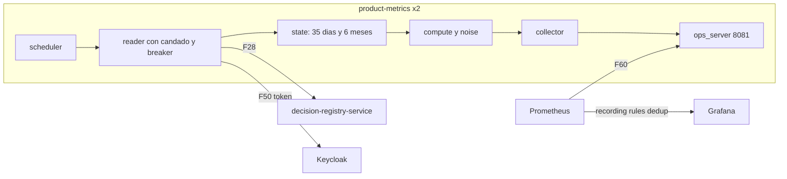

# Componentes lógicos — U11 `product-metrics`

## 1. Inventario

| Componente | Tipo | Responsabilidad | Patrón | Estado |
|---|---|---|---|---|
| `scheduler` | Tarea `asyncio` | Pasada completa al arrancar y diaria a las 02:30 UTC + desfase aleatorio, con plazo de 75 min y reintentos; ciclo incremental cada 5 min, que se omite si el candado está tomado | P-U11-01, 02 | — |
| `reader` | Módulo | Paginación por `seq` con `deps.call` hacia U3 (F28), una página a la vez, bajo un **candado único** para toda lectura; tras la pasada completa, una lectura incremental desde su `last_seq` (revisión del NFR Design de U11, 2026-10-10) | P-U11-01, 02 | **Por proceso**: breaker hacia U3 y el candado |
| `state` | Módulo | Estado de 35 días (códigos enteros, `__slots__`), contadores de 6 meses, `last_seq`; estado nuevo construido aparte y reemplazo atómico, sin reaplicar entradas | P-U11-02, 04 | **En memoria** |
| `compute` / `noise` | Funciones puras | `BusinessMetrics` inmutable desde el estado y los parámetros | FD; P-U11-03 | — |
| `collector` | `Collector` de `prometheus-client` | Publica la instantánea vigente; las series de operación, siempre | P-U11-03 | Una referencia a la instantánea |
| `ops_server` | `vectra_common` (U0) | 8081: `/metrics`, `/healthz`, `/readyz` | NFR-U11-21 | — |
| `config` | Módulo | Constantes del ciclo y parámetros de `values-product-metrics-policy.yaml` (ConfigMap) | BR-U11-09 | — |
| Reglas | `PrometheusRule` del chart | Recording rules `:dedup`, reglas de BR-U11-06 generadas por `gen_rules.py`, alertas | P-U11-05, 06 | — |
| Dashboard | `product.json` | Solo series `:dedup`; targets; nota de aproximación | BR-U11-12; P-U11-05 | — |

## 2. Diagrama



### Alternativa en texto

```text
product-metrics (2 réplicas independientes)
  scheduler -> reader (candado único, deps.call, breaker, una página a la vez) -> registro F28 (token por F50)
  reader -> state (35 días + contadores de 6 meses; estado nuevo aparte y reemplazo atómico)
  state -> compute/noise (puros) -> instantánea inmutable -> collector -> ops_server 8081
Prometheus -> 8081 (F60); recording rules max without (instance, pod) -> series :dedup -> Grafana
```

## 3. Estado

Todo el estado vive en memoria de cada réplica y se reconstruye con la pasada completa al
arrancar. No hay datos persistentes.
