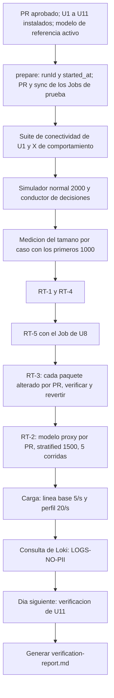

# Modelo de lógica — U12 `system-verification`

## 1. Módulos lógicos

| Módulo | Responsabilidad | Reglas |
|---|---|---|
| `simulator` | Lectura de U5, muestreo (`normal`, `stratified`), envío con ritmo, `RunReport` | BR-U12-01, 02 |
| `sampler` | Función pura: muestra estratificada con ≥ N por celda | BR-U12-01, 06 |
| `driver` | Login por el BFF y decisiones según `DecisionMix` | BR-U12-03 |
| `scenarios` | Un escenario por RT y por X de comportamiento, con su oráculo | BR-U12-04, 05 |
| `rt2_latency` | Medición de la latencia desde las entradas del registro | BR-U12-07 |
| `load` | Orquesta los scripts k6 de U7, U8 y U10 y la línea base | BR-U12-08 |
| `demos` | Guiones y `verify.sh` | BR-U12-09 |
| `report` | Función pura: `VerificationReport` desde las `Evidence` | BR-U12-11 |

`sampler`, `report` y los oráculos de `scenarios` son puros y se prueban con propiedades.

## 2. Flujos

### 2.1 Orden de una verificación completa en kind



### Alternativa en texto

```text
1. PR aprobado; U1–U11 en kind; modelo de referencia activo
1b. prepare: runId y started_at en el manifiesto -> PR de los Jobs de prueba con ese runId -> sync
2. suite de conectividad de U1 + X03, X04, X06, X10 (los Jobs de prueba ya terminados después de started_at)
3. simulador normal (2 000) + conductor de decisiones
4. tamaño por caso con los primeros 1 000
5. RT-1 (pares) y RT-4 (18 casos)
6. RT-5 (Job de U8)
7. RT-3: por cada paquete alterado: PR -> sync -> verificar -> PR de reversión -> sync
8. RT-2: PR del modelo proxy -> sync -> stratified (~1 500) -> esperar el freeze -> medir
        -> reactivar (cumplimiento) -> repetir hasta 5 corridas -> PR de vuelta al modelo de referencia
9. carga: línea base a 5/s, después 20/s + 200 usuarios
9b. consulta de Loki de LOGS-NO-PII sobre todo el periodo
10. día D + 1: verificación de U11 (métricas del día anterior)
11. generar verification-report.md
```

El orden importa: las decisiones van antes de RT-2 (que congela el modelo) y la carga, al final,
para no mezclar sus métricas con las de los escenarios.

### 2.2 Conductor de decisiones

```text
login OIDC (analista-1 o analista-2, TOTP desde ESO) por el BFF
por cada caso listo de la bandeja:
  get_case
  con probabilidad p_view: record_explanation_view
  decision = muestreo de DecisionMix (resuelve_revision solo si outcome = revision_requerida)
  used_factors = con probabilidad p_factors, una muestra de los feature_id del shap_vector; si no, ["ninguno"]
  justification si se_aparta o resuelve_revision (texto de prueba de 20..2000 caracteres)
  record_decision -> 200 cuenta; 409 o 422 cuenta y sigue, sin reintentar con otro contenido
```

## 3. Propiedades testeables (PBT-01)

| ID | Componente | Propiedad | Categoría | Generadores (PBT-07) |
|---|---|---|---|---|
| PBT-U12-01 | `sampler` | Para toda población y todo `min_per_cell` alcanzable, la muestra tiene ≥ `min_per_cell` casos en cada celda de `region` y `estrato` con datos suficientes, no repite filas y es determinista con la semilla; si una celda no alcanza, lo informa y no la rellena | Invariante | Poblaciones con distribuciones de celdas generadas, incluidas celdas pequeñas |
| PBT-U12-02 | `report` | Para todo conjunto de evidencias, un elemento sin evidencia sale `no ejecutado`, uno con `expected ≠ obtained` sale `falla` aunque su `result` diga `pasa`, y ningún elemento sale `pasa` sin una evidencia que lo respalde; una historia sale `pasa` solo si pasan todas las evidencias de su fila del mapa (domain-entities §4.2), `falla` si alguna falla y `no ejecutado` en otro caso (revisión del FD de U12, 2026-10-10) | Invariante | Conjuntos de evidencias con faltantes, contradicciones y duplicados |
| PBT-U12-03 | `driver` (mezcla) | Para toda `DecisionMix`, las decisiones generadas cumplen BR-U0-35 y 36 y BR-U8-16 (opciones según el `outcome`, justificación en rango, factores ⊆ `shap_vector` o exactamente `["ninguno"]`); con N grande, las proporciones convergen a las de la mezcla | Oráculo / estadística | Mezclas y casos generados con todos los `outcome` |
| PBT-U12-04 | `rt2_latency` | La latencia es `freeze.recorded_at − min(recorded_at de las recommendation del lote)`, nunca menor que la medida desde cualquier otra entrada del lote, y una corrida con latencia > 1 800 s sale `passed = false` (Infrastructure Design de U12, 2026-10-10) | Oráculo | Lotes de entradas y un `freeze` con tiempos generados |

**Pruebas de ejemplo obligatorias (PBT-10):**
- el simulador nunca supera 30 solicitudes/s y cada solicitud lleva una `Idempotency-Key` distinta;
- el `RunReport` no contiene ningún campo de identificación del solicitante;
- el conductor ante un 409 `decision_already_recorded` lo cuenta y sigue con el caso siguiente;
- RT-1 con un par cuya narrativa difiere → `falla`;
- RT-3 con una sola `recommendation` en la ventana → `falla`;
- RT-2 con una corrida de 31 min → la demo de RT-2 sale `falla` y la medición queda registrada;
- informe con X07 sin evidencia → `no ejecutado`;
- X04 con un Job `x04-probe` completado de otro `runId`, o con `completionTime` anterior al inicio de la verificación → `no ejecutado` (segunda revisión del Infrastructure Design de U12, 2026-10-10);
- US-111 con `RT-3` en `pasa` y `journey-7-3` sin evidencia → `no ejecutado`; US-303 con `RT2-LATENCY` en `falla` → `falla`; un `story-map.yaml` con una evidencia desconocida → el generador falla;
- `LOGS-NO-PII` con un identificador `SYN-` encontrado en Loki → `falla`;
- un guion de demo con `kubectl apply` o `argocd app sync` → la prueba de guiones falla.

## 4. Cumplimiento de extensiones (Functional Design U12)

| Regla | Estado | Evidencia |
|---|---|---|
| AUTONOMIA-01 | Cumple | BR-U12-09, 10 (sin cambios al clúster desde U12; PRs y operador) |
| AUTONOMIA-02 | Cumple | BR-U12-04, 11 (oráculos explícitos; informe que no marca `pasa` sin evidencia) |
| AUTONOMIA-03 | Cumple | RT-5, X01 (BR-U12-04, 05) |
| SECURITY-03 | Cumple | `RunReport` y `DriverReport` sin datos del solicitante |
| SECURITY-11 | Cumple | RT-1..5 y X01–X10 como casos de abuso ejecutables |
| RESILIENCY-09 | Cumple | BR-U12-08 (carga y escalado) |
| PBT-01 / 07 / 10 | Cumple | §3 |
