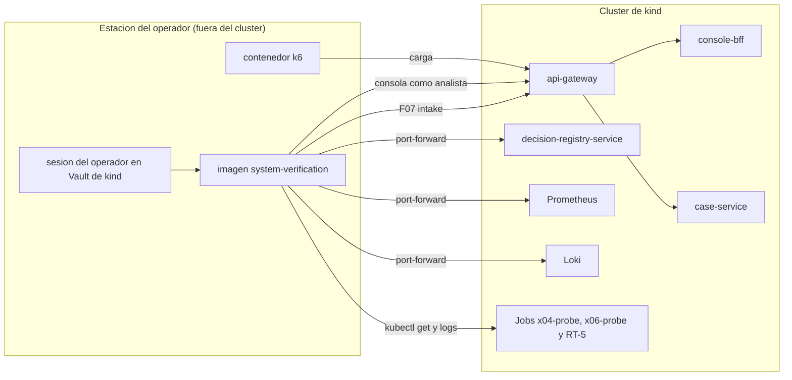

# Arquitectura de despliegue — U12 `system-verification`

U12 no se despliega en el clúster. Esta vista muestra cómo la imagen del operador llega a lo que
verifica en kind.

---

## 1. Topología

### Diagrama



### Alternativa en texto

```text
Estación del operador (fuera del clúster)
  imagen system-verification (credenciales en memoria desde el Vault de kind)
    -> gateway: /api/intake/** (F07, channel-simulator) y /api/console/** (analista-1, analista-2)
    -> port-forward a un pod (nunca a un Service): decision-registry-service (verification-reader), Prometheus, Loki
    -> kubectl get / logs: Jobs x04-probe (U9), x06-probe (U3) y RT-5 (U8)
  contenedor k6 (grafana/k6, siempre aparte, lo lanza el operador con la sección load) -> gateway (carga)
Nada de U12 corre ni se despliega dentro del clúster.
```

## 2. Ciclo de una verificación

```text
0. el operador crea la rama verification/<fecha>-<commit> en su checkout local del monorepo
1. sección prepare: genera el runId de la verificación, escribe el manifiesto inicial con started_at
   y produce el parche de values de kind (probes.runId = AAAAMMDD-HHMM de started_at en UTC, para
   x04-probe, x06-probe y rt5-demo; los tres solo en kind)
2. un PR con ese parche en los values de kind de tres Applications (bias-monitoring, decision-registry-rebuild
   y case-management) -> sync manual con prune de las tres (los tres Jobs corren después de started_at)
3. el operador ejecuta las demás secciones en orden (NFR-U12-30)
4. PRs preparados de RT-3 y RT-2 (y sus reversiones), sincronizados por el operador
5. la imagen escribe evidencias, manifiesto e informe en el directorio de evidencias del checkout
6. el operador hace commit con su identidad de Git, empuja la rama y abre el PR de verificación,
   revisado por calidad y cumplimiento (CODEOWNERS)
(pendientes posteriores al cierre, 2026-10-10)
```

## 2b. Camino de la estación al clúster (pendientes posteriores al cierre, 2026-10-10)

| Tramo | kind | staging |
|---|---|---|
| Gateway | El host `vectra.kind.local`, resuelto en la estación a la IP del puerto 443 que kind publica en el host (`extraPortMappings` del clúster de U1) | El host público de staging del gateway |
| CA | La CA interna de cert-manager de U1 (borde): el operador exporta su certificado raíz del clúster de kind y la imagen lo recibe como archivo de solo lectura | La CA del banco que firma el certificado del gateway de staging |
| API de Kubernetes | El kubeconfig de kind del operador | El kubeconfig de staging del operador, con su grupo `vectra-verification-operators` (K16) |
| `port-forward` | Por la API de Kubernetes (K16) | Igual |

**Cómo llegan las credenciales al contenedor sin escribirse en disco** (también en el README):
- el kubeconfig del operador (que ya existe en su estación) y el certificado raíz se montan como archivos de **solo lectura**; el contenedor no los copia;
- la sesión de Vault la abre el operador en su estación (`vault login`), y su token entra al contenedor como variable de entorno al arrancar, nunca como archivo;
- el sistema de archivos del contenedor es de solo lectura, salvo el directorio de evidencias montado del checkout y un `tmpfs` para el perfil de Chromium;
- el contenedor de k6 recibe solo la URL y el token de carga por variables de entorno.

## 3. Recursos que U12 usa (de otras unidades)

| Recurso | Dueño | Uso |
|---|---|---|
| Cliente `channel-simulator` | U2 | Ingesta (kind y staging) |
| Usuarios `analista-1`, `analista-2` | U2 | Conductor y RT-1 por el BFF |
| Cliente `verification-reader` | U2 | Lectura del registro |
| Binding K16 | U1 | `get`, `logs`, `port-forward` del operador |
| Jobs `x04-probe`, `x06-probe` | U9, U3 | X04, X06 |
| Job `rt5-demo` (solo kind) | U8 | RT-5 |
| Suite de conectividad | U1 | X01, X02, X05, X07, X08, X09 |
