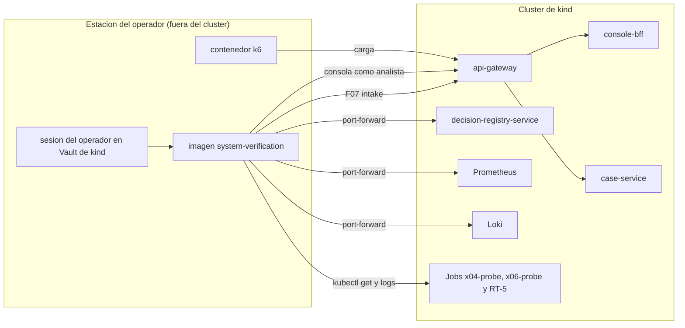

# Arquitectura de despliegue — U12 `system-verification`

U12 no se despliega en el clúster. Esta vista muestra cómo la imagen del operador llega a lo que
verifica en kind.

---

## 1. Topología

### Diagrama



### Alternativa en texto

```text
Estación del operador (fuera del clúster)
  imagen system-verification (credenciales en memoria desde el Vault de kind)
    -> gateway: /api/intake/** (F07, channel-simulator) y /api/console/** (analista-1, analista-2)
    -> port-forward: decision-registry-service (verification-reader), Prometheus, Loki
    -> kubectl get / logs: Jobs x04-probe (U9), x06-probe (U3) y RT-5 (U8)
  contenedor k6 -> gateway (carga)
Nada de U12 corre ni se despliega dentro del clúster.
```

## 2. Ciclo de una verificación

```text
1. PR con los runId de los Jobs de prueba (x04, x06, RT-5) en los values de kind -> sync manual
2. el operador ejecuta la imagen por secciones (NFR-U12-30)
3. PRs preparados de RT-3 y RT-2 (y sus reversiones), sincronizados por el operador
4. la imagen escribe las evidencias, el manifiesto y el informe en la rama verification/<fecha>-<commit>
5. PR de verificación revisado por calidad y cumplimiento (CODEOWNERS)
```

## 3. Recursos que U12 usa (de otras unidades)

| Recurso | Dueño | Uso |
|---|---|---|
| Cliente `channel-simulator` | U2 | Ingesta (kind y staging) |
| Usuarios `analista-1`, `analista-2` | U2 | Conductor y RT-1 por el BFF |
| Cliente `verification-reader` | U2 | Lectura del registro |
| Binding K16 | U1 | `get`, `logs`, `port-forward` del operador |
| Jobs `x04-probe`, `x06-probe` | U9, U3 | X04, X06 |
| Job de RT-5 | U8 | RT-5 |
| Suite de conectividad | U1 | X01, X02, X05, X07, X08, X09 |
