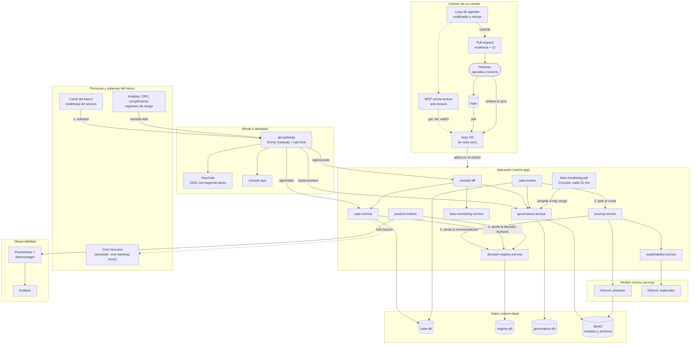

# Diagrama de arquitectura

Vista lógica de Vectra Risk: quién usa el sistema, por dónde entra una solicitud de crédito de vivienda, qué servicios la procesan y por dónde llega un cambio al clúster. Los nombres son los de los objetos que corren en `kind-vectra`; el inventario se leyó del clúster el 27 de noviembre de 2026.

Diagramas relacionados: [componentes tecnológicos](diagrama-componentes-tecnologicos.md) y [clúster](diagrama-cluster.md).

## Cómo leerlo

El diagrama tiene dos recorridos que no se cruzan: el de un **caso de crédito** (arriba y al centro) y el de un **cambio en el sistema** (abajo).

### El recorrido de un caso

1. **Entra la solicitud.** El canal del banco la envía con una credencial de servicio. Pasa por `api-gateway` (Envoy Gateway, con límite de peticiones) y llega a `case-service` por la ruta `/api/intake`.
2. **Se pide el score.** `case-worker` toma el caso, consulta a `governance-service` qué versión del modelo está activa y le pide a `scoring-service` el puntaje. `scoring-service` llama al predictor de KServe y, a través de `explainability-service`, al explicador.
3. **Se anota la recomendación.** La recomendación queda escrita en `decision-registry-service`, un registro al que solo se le añade. El caso pasa a «Listo».
4. **Decide una persona.** El analista entra a la consola (`console-spa` y `console-bff`) con contraseña y segundo factor de Keycloak, ve la recomendación, la explicación y los datos, y registra su decisión. Esa decisión también queda en el registro, junto a la recomendación. El caso pasa a «Decidido».

Medido el 27 de noviembre de 2026 contra `kind-vectra`: de la solicitud al caso «Listo» pasaron 5 segundos.

### Lo que vigila el sistema mientras tanto

- **Sesgo.** `bias-monitoring-job` corre cada 15 minutos y, si la disparidad entre grupos supera el límite, le ordena a `governance-service` congelar el modelo. Es la demo D2.
- **Sin explicación no hay recomendación.** Si la explicación no está disponible, el caso no recibe recomendación (fail-closed). Es la demo D1.
- **El core bancario no se escribe.** `case-service` solo lee del core; la malla niega cualquier escritura. Es la demo D3. En kind el core es un simulador (`core-banking-mock`).
- **Métricas de producto.** `product-metrics` lee el registro y publica en Prometheus las series que Grafana muestra en el tablero «Producto». Es la demo D4.

### El recorrido de un cambio

Ningún cambio llega al clúster por una orden directa.

1. El **loop de agentes** (un codificador y un revisor) trabaja sobre una tarea y termina en un **pull request** con la evidencia adjunta. Lo único que un agente puede hacer contra el clúster es leer, a través del servidor MCP `vectra-lectura`, con la cuenta `vectra-readonly-agent`.
2. Una **persona** revisa, aprueba y fusiona en `main`.
3. **Argo CD** toma lo que hay en `main`, pero no sincroniza solo: la misma persona ordena el sync. Solo entonces el cambio se aplica.

## Fronteras que conviene tener presentes

| Frontera | Qué la impone |
|---|---|
| Internet y usuarios frente al clúster | `api-gateway`: solo las rutas declaradas; lo demás bajo `/api` y `/auth` está cerrado |
| Quién es quién | Keycloak: usuarios con segundo factor y clientes de servicio con llave propia |
| Servicio a servicio | Linkerd (mTLS) y `NetworkPolicy`, generadas desde una lista de flujos permitidos |
| Agentes frente al clúster | RBAC de solo lectura, lista cerrada de herramientas MCP y reglas `deny` |
| Git frente al clúster | Argo CD sin auto-sync: una persona ordena cada sincronización |

## Límites de este diagrama

- Es una vista lógica: no muestra réplicas, namespaces de plataforma ni tareas programadas. Eso está en el [diagrama del clúster](diagrama-cluster.md).
- Las flechas entre servicios salen del diagrama del `README.md` raíz, de las rutas del gateway y de la configuración de los servicios. No se dibujan los 119 flujos de red declarados en `platform/network/flows.yaml`.
- Todo corre en kind, con datos y modelo sintéticos. Staging y producción no se desplegaron.
