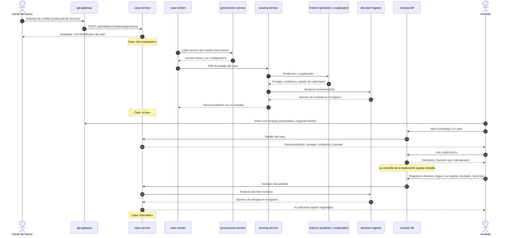
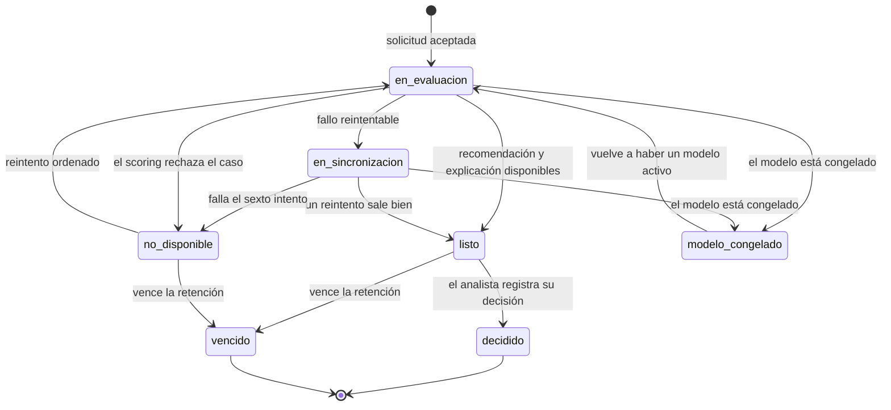

# Diagrama del caso completo de crédito de vivienda

Qué le pasa a una solicitud desde que entra hasta que una persona la decide, y por qué estados puede pasar el caso. El recorrido se ejecutó contra `kind-vectra` el 27 de noviembre de 2026: la solicitud quedó «Listo» en 5 segundos y, tras la decisión del analista en la consola, «Decidido».

Diagramas relacionados: [arquitectura](diagrama-arquitectura.md), [viaje de los usuarios](diagrama-viaje-usuarios.md) y [clúster](diagrama-cluster.md).

## 1. La secuencia: de la solicitud a la decisión



### Cómo leerlo

El diagrama se lee de arriba abajo; cada flecha es una llamada y cada línea punteada, su respuesta.

- **Pasos 1 a 3 · Entra la solicitud.** El canal del banco la envía con una credencial de servicio, no con un usuario. El gateway solo deja pasar la ruta de ingreso declarada. `case-service` responde enseguida con el identificador del caso: la evaluación ocurre después.
- **Pasos 4 a 11 · El modelo recomienda.** `case-worker` pregunta primero a gobierno qué versión del modelo está activa, porque un modelo congelado no puede recomendar. Luego pide el puntaje; `scoring-service` obtiene del modelo la predicción y la explicación, y **anota la recomendación en el registro antes de devolverla**. El caso pasa a «Listo» con el número de esa entrada.
- **Pasos 12 a 17 · El analista revisa.** Entra con contraseña y segundo factor. En el caso ve el resultado, el puntaje, la confianza y las razones; al pedir la explicación ve la narrativa y el aporte de cada factor. Abrir la explicación queda contado: es una de las métricas de producto.
- **Pasos 18 a 22 · Decide una persona.** El analista dice si sigue la recomendación o se aparta, cuál es el resultado final y qué factores usó. Si se aparta, la consola exige una justificación escrita. La decisión queda en el registro junto a la recomendación, y el caso pasa a «Decidido».

El par que queda en el registro, lo que recomendó el modelo y lo que decidió la persona, es lo que permite medir después si las decisiones del modelo se sostienen.

## 2. Los estados del caso



### Cómo leerlo

Los estados y las transiciones salen de la máquina de estados del código (`case-management/src/vectra_case/case_fsm.py`).

| Estado | En la consola | Qué significa |
|---|---|---|
| `en_evaluacion` | En evaluación | La solicitud entró y el caso espera su recomendación |
| `listo` | Listo | Hay recomendación y explicación; falta la decisión de la persona |
| `decidido` | Decidido | El analista registró su decisión. Es un estado final |
| `en_sincronizacion` | En sincronización | Falló una llamada y el caso se reintenta, con esperas crecientes, hasta 6 intentos |
| `no_disponible` | No disponible | No se pudo obtener una recomendación. El banco sigue con su proceso manual |
| `modelo_congelado` | Modelo congelado | El modelo fue congelado, por ejemplo por sesgo; el caso espera a que haya uno activo |
| `vencido` | Vencido | Pasó el plazo de retención sin decisión. Es un estado final |

Tres cosas que este diagrama deja ver:

- **El camino feliz es corto:** en evaluación, listo, decidido.
- **Sin explicación no hay recomendación.** Si el modelo o la explicación fallan, el caso no llega a «Listo»: se reintenta y, si no hay forma, queda «No disponible». Es la demo D1.
- **Un modelo congelado detiene las recomendaciones, no las solicitudes.** Los casos esperan en «Modelo congelado» y vuelven a evaluarse cuando hay un modelo activo. Es la demo D2.

`vencido` también se alcanza desde `en_evaluacion`, `en_sincronizacion` y `modelo_congelado`; no se dibujan esas flechas para no recargar el diagrama.

## Cómo reproducirlo

```bash
~/.vectra-verification/bin/caso-en-vivo.sh
```

El guion envía una solicitud por el canal, espera al caso «Listo» e imprime su identificador y la dirección para abrirlo en la consola. La decisión se registra a mano, con el usuario `analista-1`. El guion vive fuera del repositorio, en la máquina de la demo.

## Límites de este diagrama

- La secuencia resume las llamadas principales. No muestra la autenticación entre servicios, la malla ni la lectura del core bancario.
- El orden de los pasos 4 a 11 sale de la configuración de `case-worker` y del diagrama del `README.md` raíz; no tracé cada llamada en el código.
- Los datos y el modelo son sintéticos. La solicitud de ejemplo da siempre «favorable».
