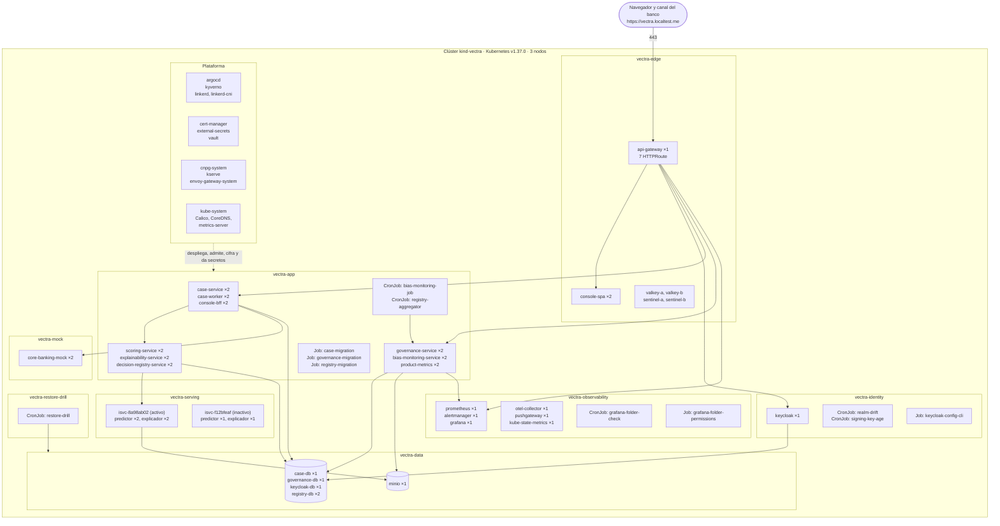

# Diagrama del clúster

Lo que corre dentro de `kind-vectra`: namespaces, servicios, bases de datos, tareas programadas (`CronJob`) y tareas de una sola vez (`Job`). Inventario leído del clúster el 27 de noviembre de 2026, con `kubectl get` sobre cada tipo de objeto.

Diagramas relacionados: [arquitectura](diagrama-arquitectura.md) y [componentes tecnológicos](diagrama-componentes-tecnologicos.md).

## Cómo leerlo

Cada recuadro interior es un **namespace**. El número tras «×» son las réplicas que estaban listas. Las flechas continuas son tráfico de la aplicación; la punteada resume lo que la plataforma le da a todo lo demás.

El clúster tiene tres nodos (`vectra-control-plane`, `vectra-worker` y `vectra-worker2`) y, en reposo, 93 pods en `Running`.

### Namespaces de la aplicación

| Namespace | Qué contiene | Para qué |
|---|---|---|
| `vectra-edge` | `api-gateway`, `console-spa`, Valkey y Sentinel | La única puerta de entrada y la consola web; Valkey guarda los contadores del límite de peticiones |
| `vectra-identity` | `keycloak` | Inicio de sesión de personas y servicios |
| `vectra-app` | Nueve servicios de negocio | Casos, scoring, explicación, registro, gobierno, sesgo y métricas |
| `vectra-serving` | Dos `InferenceService` de KServe | Una versión del modelo activa y otra inactiva, lista para un rollback |
| `vectra-data` | Cuatro bases PostgreSQL y MinIO | Persistencia |
| `vectra-mock` | `core-banking-mock` | Simula el core bancario; solo existe en kind y staging |
| `vectra-observability` | Prometheus, Alertmanager, Grafana y recolectores | Métricas, alertas y tableros |
| `vectra-restore-drill` | Un `CronJob` | Simulacro semanal de restauración de respaldos |
| `vectra-staging` | Vacío (solo un `Gateway` declarado) | Reservado; staging no se desplegó |

### Servicios de `vectra-app`

Todos exponen dos puertos, el 8080 y el 8081, salvo `case-worker` y `product-metrics`, que solo tienen el 8081.

| Servicio | Réplicas | Qué hace |
|---|---|---|
| `case-service` | 2 | Recibe las solicitudes y sirve los casos a la consola |
| `case-worker` | 2 | Procesa cada caso: pide el score y lo deja «Listo» |
| `console-bff` | 2 | Servidor intermedio de la consola: sesión y permisos por rol |
| `scoring-service` | 2 | Llama al modelo y arma la recomendación |
| `explainability-service` | 2 | Obtiene la explicación del score |
| `decision-registry-service` | 2 | Registro de decisiones al que solo se le añade |
| `governance-service` | 2 | Versiones del modelo: activar, congelar, reactivar |
| `bias-monitoring-service` | 2 | Sirve los congelamientos y el estado del sesgo a la consola |
| `product-metrics` | 2 | Lee el registro y publica las métricas de producto |

Los servicios con autoescalador tienen mínimo y máximo iguales (2 y 2): en kind no hay memoria para escalar, y por eso la alerta `HPAMaxedOut` aparece siempre.

### Rutas del gateway

Las siete `HTTPRoute` de `vectra-edge` son todo lo que se puede alcanzar desde fuera.

| Ruta | Prefijo | Destino |
|---|---|---|
| `spa` | `/` | `console-spa` |
| `auth` | `/auth/realms/vectra/…` (solo las rutas de OIDC) | `keycloak` |
| `intake` | `/api/intake/v1/intake/applications` | `case-service` |
| `console` | `/api/console` | `console-bff` |
| `promotion` | `/api/promotion/v1/models` | `governance-service` |
| `grafana` | `/grafana` | Grafana (en kind no funciona el inicio de sesión por esta ruta; se entra por port-forward) |
| `closed` | `/api`, `/auth`, `/federate` | Ninguno: cierra todo lo que no esté declarado arriba |

### Tareas programadas (`CronJob`)

| Tarea | Namespace | Horario (UTC) | Qué hace |
|---|---|---|---|
| `bias-monitoring-job` | `vectra-app` | Minutos 2, 17, 32 y 47 de cada hora | Mide la disparidad entre grupos y congela el modelo si supera el límite |
| `registry-aggregator` | `vectra-app` | Cada 5 minutos | Cuenta las recomendaciones y decisiones del registro en tablas de totales, sin contar dos veces |
| `signing-key-age` | `vectra-identity` | Cada hora | Publica la fecha de la llave de firma de Keycloak; una alerta salta si pasa de 80 días |
| `realm-drift` | `vectra-identity` | 03:00 (22:00 de Colombia) | Compara el realm de Keycloak con el declarado en Git |
| `grafana-folder-check` | `vectra-observability` | Cada 30 minutos | Comprueba que las carpetas de Grafana sean las declaradas |
| `restore-drill` | `vectra-restore-drill` | Domingos a las 02:00 | Simulacro de restauración de un respaldo |

### Tareas de una sola vez (`Job`)

| Tarea | Namespace | Qué hace |
|---|---|---|
| `case-migration`, `governance-migration`, `registry-migration` | `vectra-app` | Migraciones de esquema de cada base antes de arrancar el servicio |
| `keycloak-config-cli` | `vectra-identity` | Importa el realm tras cada sincronización de Keycloak |
| `grafana-folder-permissions` | `vectra-observability` | Fija los permisos de las carpetas de Grafana |
| `kyverno-migrate-resources` | `kyverno` | Migración propia de Kyverno al instalarse |

### Bases de datos

| Base | Instancias | La usa |
|---|---|---|
| `case-db` | 1 | `case-service` y `case-worker` |
| `registry-db` | 2 (una réplica síncrona) | `decision-registry-service` |
| `governance-db` | 1 | `governance-service` |
| `keycloak-db` | 1 | `keycloak` |

### Namespaces de plataforma

| Namespace | Qué aporta |
|---|---|
| `argocd` | Despliegue: 56 `Application`, en 7 olas, sin sincronización automática |
| `kyverno` | Admisión: rechaza lo que no cumple las políticas |
| `linkerd`, `linkerd-cni` | Malla: mTLS y autorización entre servicios |
| `cert-manager` | Certificados y la autoridad interna |
| `vault`, `external-secrets` | Secretos: Vault los guarda y External Secrets los entrega |
| `cnpg-system` | Operador de PostgreSQL |
| `kserve` | Controlador de los `InferenceService` |
| `envoy-gateway-system` | Controlador del gateway y `envoy-ratelimit` |
| `kube-system` | Calico, CoreDNS, `kube-proxy` y `metrics-server` |

## Qué mirar si algo falla

- **Tras reiniciar la máquina**, los pods con malla quedan en `Unknown` y la bóveda pierde lo sembrado. El orden de recuperación está en `platform/runbooks/install.md`, «Tras reiniciar la máquina».
- **Las tareas programadas que caen durante un reinicio** quedan en `Error` y dejan su aplicación de Argo CD en `Degraded` hasta la siguiente corrida. No es un defecto.
- **`kserve-crd` y `linkerd-control-plane`** aparecen `OutOfSync` pero sanas; es un estado aceptado y documentado en el runbook.

## Límites de este diagrama

- Es una foto del 27 de noviembre de 2026 en kind. Las réplicas están fijadas por el presupuesto de memoria del portátil, no por la carga.
- No dibuja cada `Service`, `NetworkPolicy` ni `ExternalSecret`; hay 71 `ExternalSecret` y cientos de políticas de red generadas.
- Qué hace cada recurso y qué parte del negocio sostiene está en [`recursos-del-cluster.md`](recursos-del-cluster.md); la descripción de las tareas programadas sale de su código.
