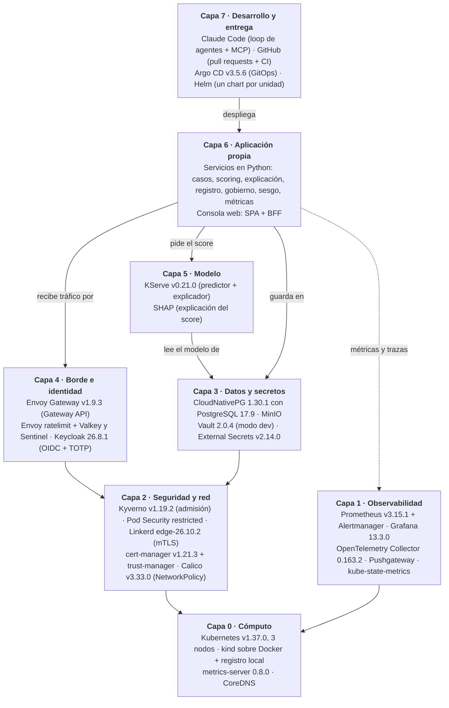

# Diagrama de componentes tecnológicos

Qué tecnología hay en cada capa de Vectra Risk y para qué se usa. Las versiones son las que corrían en `kind-vectra` el 27 de noviembre de 2026, leídas de las imágenes y etiquetas de cada carga.

Diagramas relacionados: [arquitectura](diagrama-arquitectura.md) y [clúster](diagrama-cluster.md).

## Cómo leerlo

Cada recuadro es una capa y se apoya en las de abajo. Una flecha continua significa «depende de»; la punteada, «le envía telemetría». Las tablas siguientes detallan cada componente.

### Capa 0 · Cómputo

| Componente | Versión | Para qué |
|---|---|---|
| Kubernetes | v1.37.0 | Orquestador. Tres nodos: un plano de control y dos de trabajo |
| kind sobre Docker | kind v0.33.0 | Cada nodo es un contenedor; es lo que permite correr todo en un portátil |
| Registro local | `kind-registry` | Guarda las imágenes propias; los nodos lo ven como `registro.vectra.internal` |
| metrics-server y CoreDNS | 0.8.0 | Métricas de uso para los autoescaladores y resolución de nombres |

### Capa 1 · Observabilidad

| Componente | Versión | Para qué |
|---|---|---|
| Prometheus y Alertmanager | v3.15.1 | Recogen métricas y evalúan las reglas de alerta |
| Grafana | 13.3.0 | Cinco tableros; el de «Producto» es la demo D4 |
| OpenTelemetry Collector | 0.163.2 | Recibe la telemetría de los servicios |
| Pushgateway y kube-state-metrics | — | Métricas de tareas cortas y del estado de los objetos del clúster |

### Capa 2 · Seguridad y red

| Componente | Versión | Para qué |
|---|---|---|
| Kyverno | v1.19.2 | Rechaza en la admisión lo que no cumple: imágenes `latest`, privilegios, auto-sync |
| Pod Security | integrado | Los namespaces `vectra-*` exigen el perfil `restricted` |
| Linkerd | edge-26.10.2 | mTLS entre servicios y autorización por flujo |
| Calico | v3.33.0 | Red de pods y `NetworkPolicy` |
| cert-manager y trust-manager | v1.21.3 | Autoridad interna y certificados, incluido el de `https://vectra.localtest.me` |

### Capa 3 · Datos y secretos

| Componente | Versión | Para qué |
|---|---|---|
| CloudNativePG | 1.30.1, con PostgreSQL 17.9 | Cuatro bases: casos, registro de decisiones, gobierno y Keycloak |
| MinIO | RELEASE.2025-10-15 | Objetos: modelos, archivos del registro y de gobierno |
| Vault | 2.0.4 | Guarda los secretos. En kind corre en modo dev, en memoria |
| External Secrets | v2.14.0 | Copia los secretos de Vault a `Secret` de Kubernetes |

### Capa 4 · Borde e identidad

| Componente | Versión | Para qué |
|---|---|---|
| Envoy Gateway | v1.9.3 | Única entrada: `Gateway`, `HTTPRoute` y `SecurityPolicy` |
| Envoy ratelimit con Valkey y Sentinel | — | Límite de peticiones por cliente |
| Keycloak | 26.8.1 | Inicio de sesión OIDC con segundo factor y clientes de servicio |

### Capa 5 · Modelo

| Componente | Versión | Para qué |
|---|---|---|
| KServe | v0.21.0 | Sirve cada versión del modelo como un `InferenceService` con predictor y explicador |
| SHAP | — | Método de la explicación: qué variables movieron el riesgo estimado |

### Capa 6 · Aplicación propia

| Componente | Para qué |
|---|---|
| Servicios en Python | Casos, scoring, explicación, registro de decisiones, gobierno de modelos, monitoreo de sesgo y métricas de producto. Cada unidad tiene su chart de Helm |
| Consola web | Una aplicación de página única (`console-spa`) y su servidor intermedio (`console-bff`), en español, inglés y portugués |

### Capa 7 · Desarrollo y entrega

| Componente | Versión | Para qué |
|---|---|---|
| Claude Code | — | El loop de agentes: orquestador, codificador y revisor, más el servidor MCP de solo lectura |
| GitHub | — | Pull requests, revisión obligatoria y siete comprobaciones de CI sobre `main` |
| Argo CD | v3.5.6 | Lleva `main` al clúster: 56 `Application`, ninguna con sincronización automática |
| Helm | v4.3.0 | Empaqueta cada unidad y los componentes de plataforma |

## Por qué estas piezas y no otras

- **Todo es self-hosted.** Ninguna capa depende de un servicio en la nube, porque el argumento del producto es que el dato del banco no sale de su clúster.
- **La seguridad no depende de la aplicación.** Admisión, malla, red y secretos están en capas propias; un servicio mal escrito sigue sin poder hablar con quien no debe.
- **GitOps arriba del todo.** Lo que hay en el clúster es lo que hay en `main`; por eso los agentes pueden proponer cambios sin tener permiso de aplicarlos.

## Límites de este diagrama

- Las versiones son las del clúster kind el 27 de noviembre de 2026; no hay otro entorno desplegado.
- Vault en modo dev, imágenes sin firma ni SBOM y MinIO (cuyo repositorio está archivado desde abril de 2026) son deudas declaradas en la sección 8 del `README.md` raíz.
- Donde la versión dice «—», no la leí del clúster.
