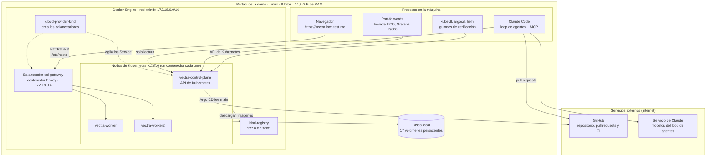

# Diagrama de infraestructura

Sobre qué corre Vectra Risk: la máquina, Docker, los contenedores que forman el clúster kind, la red y los servicios externos de los que depende. Leído de la máquina de la demo el 27 de noviembre de 2026 (`docker ps`, `docker network inspect kind` y `kubectl`).

Diagramas relacionados: [clúster](diagrama-cluster.md) y [componentes tecnológicos](diagrama-componentes-tecnologicos.md).

## Cómo leerlo

Hay tres niveles, uno dentro de otro: la máquina, Docker y los contenedores. Todo el «clúster» es un conjunto de contenedores en un solo portátil.

### La máquina

| Elemento | Detalle |
|---|---|
| Equipo | Un portátil con Linux, 8 hilos de CPU y 14,8 GiB de RAM |
| Requisito | Docker Engine nativo; 14 GiB de RAM como mínimo, 16 recomendados |
| Riesgo conocido | Con un cargador de poca potencia el equipo limita la CPU y el clúster empieza a dar tiempos de espera |

### Los contenedores de Docker

| Contenedor | Imagen | Para qué |
|---|---|---|
| `vectra-control-plane` | `kindest/node:v1.37.0` | Plano de control: la API de Kubernetes, el planificador y etcd |
| `vectra-worker`, `vectra-worker2` | `kindest/node:v1.37.0` | Nodos de trabajo: aquí corren los pods de la aplicación |
| `kind-registry` | `registry:3.0.0` | Registro de imágenes local. La máquina lo ve en `127.0.0.1:5001`; los nodos, como `registro.vectra.internal` |
| `cloud-provider-kind` | `cloud-controller-manager:v0.12.0` | Hace el papel del proveedor de nube: crea un balanceador por cada `Service` de tipo `LoadBalancer` |
| `kindccm-…` (dos) | `envoyproxy/envoy:v1.33.2` | Los balanceadores que crea `cloud-provider-kind`. Uno es el del gateway de Vectra |

### La red

- Todos los contenedores están en la red de Docker `kind`, `172.18.0.0/16`.
- El gateway de Vectra es un `Service` de tipo `LoadBalancer`. Su dirección externa, hoy `172.18.0.4`, la da su contenedor balanceador.
- El navegador llega por nombre: `/etc/hosts` asocia `vectra.localtest.me` a esa dirección. **Docker puede reasignarla tras un reinicio**; `platform/kind/gateway-address.sh` lo comprueba e imprime la línea que hace falta.
- El certificado de `https://vectra.localtest.me` lo emite la autoridad interna del clúster; el navegador debe confiar en ella (sección 7 del `README.md` raíz).
- Dentro del clúster, la red de pods es de Calico y el tráfico entre servicios va cifrado por Linkerd.

### El almacenamiento

- Una sola clase de almacenamiento, `standard`, que guarda cada volumen en el disco del nodo.
- 17 volúmenes persistentes: las bases PostgreSQL, MinIO, Prometheus y otros.
- **Vault es la excepción:** en kind corre en modo dev y guarda todo en memoria. Si su pod se reinicia hay que volver a sembrarlo con `platform/kind/seed-vault.sh`.

### Los accesos desde la máquina

| Acceso | Por dónde | Para qué |
|---|---|---|
| Consola web | `https://vectra.localtest.me`, por el balanceador | Lo que ven los usuarios |
| API de Kubernetes | Un puerto local hacia el plano de control | `kubectl`, `argocd`, `helm` |
| Bóveda | Port-forward al puerto 8200 | Los guiones de verificación leen de ella las credenciales de prueba |
| Grafana | Port-forward al puerto 13000 | Tableros; en kind no se entra por el gateway |
| Agentes | Un kubeconfig de solo lectura | El servidor MCP y los agentes solo pueden leer |

### Lo que está fuera de la máquina

- **GitHub** guarda el repositorio, los pull requests y la CI. Argo CD lee de ahí la rama `main`: sin internet no hay sincronización.
- **El servicio de Claude** atiende a los modelos del loop de agentes. La demo de tres minutos lo necesita; la aplicación de crédito, no.

Ningún dato de una solicitud sale de la máquina: la aplicación no llama a ningún servicio externo.

## Qué pasa al reiniciar la máquina

1. Los contenedores vuelven con Docker, pero muchos pods quedan en `Unknown` y hay que recrearlos, empezando por los de la malla.
2. Vault pierde lo sembrado y hay que resembrarlo.
3. La dirección del gateway puede cambiar.
4. La sesión de Argo CD caduca a las 24 horas.

El orden completo está en `platform/runbooks/install.md`, «Tras reiniciar la máquina». Medido el 27 de noviembre de 2026: unos 17 minutos del encendido a las pruebas de humo en verde.

## Límites de este diagrama

- Es la infraestructura de **kind**, la única desplegada. Los manifiestos de staging y producción existen sin probar.
- No hay alta disponibilidad real: los tres nodos comparten un mismo equipo y un mismo disco.
- La dirección `172.18.0.4` es la de hoy; no es estable.
