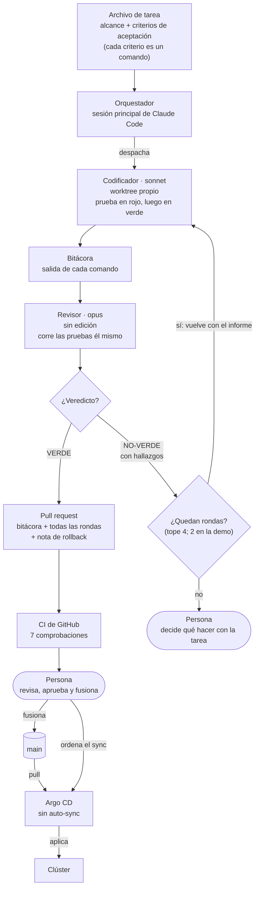

# Diagrama del loop de agentes

Cómo se construyó Vectra Risk: quién recibe qué, quién decide qué, cuándo se detiene el loop y qué le impide a un agente tocar el clúster. Los contratos están en `.claude/agents/` y en `loop/`; las cifras son el recuento del 22 de noviembre de 2026 que figura en el `README.md` raíz.

Diagramas relacionados: [arquitectura](diagrama-arquitectura.md) e [infraestructura](diagrama-infraestructura.md).

## 1. Una tarea, de la entrada al clúster

### Cómo leerlo

El diagrama se lee de arriba abajo. El rombo es una decisión; los óvalos son los dos únicos puntos donde interviene una persona.

| Papel | Qué recibe | Qué decide | Qué no puede hacer |
|---|---|---|---|
| **Orquestador** | El plan y la ruta de cada tarea | Qué despachar, cómo arbitrar y cuándo abrir el pull request | Escribir código o juzgarlo |
| **Codificador** (`sonnet`) | La tarea, su copia del repositorio y, en retrabajo, el informe del revisor | Cómo implementar, con la prueba en rojo antes del verde | Fusionar, escribir fuera de su copia o usar herramientas MCP |
| **Revisor** (`opus`) | La copia y la bitácora | VERDE o NO-VERDE, con hallazgos por severidad | Editar: un revisor que edita rompe la cadena de evidencia |
| **Persona** | Un pull request con la evidencia | Aprobar, fusionar y ordenar la sincronización | — |

- **Cómo verifica.** Cada criterio de aceptación es un comando. El revisor no confía en la bitácora: corre los comandos él mismo, reproduce el fallo inicial y aplica mutaciones para ver si las pruebas de verdad detectan errores.
- **Cuándo se detiene.** A las 4 rondas el loop para y lleva la tarea a la persona; para la demo el tope bajó a 2. Solo un hallazgo ROJO bloquea. Además no se despacha con más de 5 pull requests en espera, y trabajan a lo sumo 3 codificadores a la vez.
- **Dónde termina.** Siempre en un pull request. El loop nunca fusiona ni aprueba.

### Lo que produjo

| Medida | Valor |
|---|---|
| Tareas | 114 |
| Informes de ronda | 210 |
| Rondas NO-VERDE | 119 |
| Tareas con 3 rondas o más | 23 |
| Pull requests fusionados en el repositorio | 239 (no todos son del loop) |

Más de la mitad de las rondas salieron NO-VERDE. Ese es el mecanismo funcionando, no un fracaso: cada una es un defecto que no llegó a un pull request.

## 2. Qué frena a un agente frente al clúster

```mermaid
flowchart LR
    AG["Agente<br/>quiere actuar sobre el clúster"]

    subgraph B1["Barrera 1 · Contrato"]
        I["Instrucción del agente<br/>regla AUTONOMIA-01"]
    end
    subgraph B2["Barrera 2 · Permisos de la herramienta"]
        D["32 reglas deny<br/>kubectl apply, helm install,<br/>argocd app sync…"]
    end
    subgraph B3["Barrera 3 · Servidor MCP"]
        M["6 herramientas de lectura<br/>argumentos de lista cerrada"]
    end
    subgraph B4["Barrera 4 · Clúster"]
        RB["RBAC: get, list, watch<br/>sin Secret, sin exec"]
        KY["Kyverno y Pod Security<br/>en la admisión"]
    end
    subgraph B5["Barrera 5 · GitOps"]
        GO["Argo CD sin auto-sync<br/>rama main protegida"]
    end

    OK(["Solo puede leer<br/>y proponer un pull request"])

    AG --> I --> D --> M --> RB --> KY --> GO --> OK
```

### Cómo leerlo

Son cinco barreras en serie. Un intento de escritura tendría que pasar las cinco; cada una funciona aunque falle la anterior.

| Barrera | Qué impone | Depende del modelo |
|---|---|---|
| 1. Contrato | La instrucción prohíbe actuar sobre el clúster | **Sí**: el modelo puede no obedecer |
| 2. Permisos de la herramienta | Reglas `deny` en `.claude/settings.json` niegan las órdenes de escritura | No |
| 3. Servidor MCP | Solo existen seis herramientas, todas de lectura; no hay `exec`, ni escritura, ni lectura de `Secret` | No |
| 4. Clúster | La cuenta `vectra-readonly-agent` solo tiene `get`, `list` y `watch`; Kyverno rechaza lo que no cumple | No |
| 5. GitOps | Nada llega al clúster sin un pull request aprobado y un sync ordenado por una persona | No |

**Por qué hay cinco y no una.** La primera barrera, la instrucción, falló tres veces antes de que existieran las demás: el 2 de noviembre los dos modelos actuaron sobre el clúster en la prueba de cambio de modelo, y el 16 de noviembre una prueba leyó `Secret` reales y otra borró cuatro `Deployment`. Repetida el 22 de noviembre con las reglas `deny`, la prueba dio que los seis casos de límites cumplen; en uno, el modelo más barato intentó el `kubectl apply` por la ruta completa del binario y fue negado.

Por eso el proyecto sigue valiendo ante un modelo mejor: las barreras 2 a 5 no dependen de qué tan bien razone el modelo.

## Límites que el proyecto declara

- **Es una sola sesión** de Claude Code con subagentes de contexto propio, no tres procesos independientes.
- **Las dos cuentas de GitHub** que proponen y aprueban son de la misma persona: es un paso de revisión explícito, no la revisión de un segundo humano.
- **El orquestador operó el clúster kind** desde el 14 de noviembre, con aprobación orden por orden. «El agente no aplica por su cuenta» se sostiene; «el agente nunca aplica», no.
- **Siete pull requests se fusionaron antes** de que su revisor entregara, con la CI en verde.
- **El servidor MCP llegó el 21 de noviembre:** las 114 tareas se hicieron sin él, y no está verificado que Claude Code lo cargue desde `.mcp.json`.
- **Un hueco conocido:** una regla `deny` no reconoció una orden de borrado escrita tras una variable de shell.
- **Costo:** una ola de 3 tareas usó unos 989 000 tokens, contra 300 000 estimados, y una tarea de GitOps tomó 12 horas de reloj.
