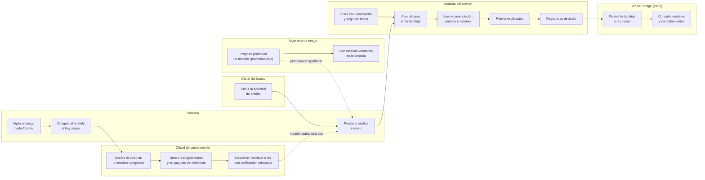
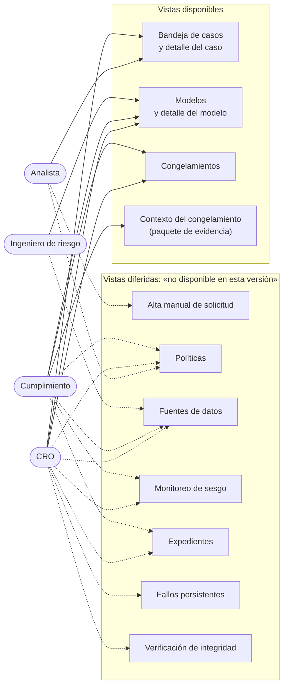

# Diagrama del viaje de los usuarios

Qué hace cada persona en Vectra Risk, por dónde entra y qué puede ver. Los roles y las vistas salen de la tabla de rutas de la consola (`console/spa/src/views/shared/routes.ts`); el recorrido del analista se ejecutó contra `kind-vectra` el 27 de noviembre de 2026.

Diagramas relacionados: [caso completo de crédito de vivienda](diagrama-caso-credito-vivienda.md) y [arquitectura](diagrama-arquitectura.md).

## 1. Quién hace qué a lo largo de un caso

### Cómo leerlo

Cada recuadro es una persona (o el sistema) y, dentro, sus pasos en orden. Las flechas entre recuadros muestran cuándo el trabajo de uno desencadena el de otro.

| Quién | Qué busca | Su recorrido |
|---|---|---|
| **Canal del banco** | Que la solicitud se evalúe | Envía la solicitud; no usa la consola |
| **Analista del comité** | Decidir rápido y poder defender la decisión | Entra, abre el caso, lee la recomendación, pide la explicación y registra si la sigue o se aparta |
| **VP de Riesgo (CRO)** | Saber si el modelo sirve y si se puede defender | Mira la bandeja y los casos, las versiones del modelo y los congelamientos |
| **Oficial de cumplimiento** | Que un modelo sesgado no siga decidiendo | Ve el congelamiento con su evidencia y decide si se reactiva, con un segundo factor reciente |
| **Ingeniero de riesgo** | Llevar un modelo nuevo a producción sin saltarse controles | Propone la promoción con `promotion-tool`, que abre un pull request; consulta las versiones en la consola |

El punto central: **el modelo recomienda y una persona decide**. El sistema nunca cierra un caso por su cuenta, y nunca reactiva un modelo congelado sin el oficial de cumplimiento.

## 2. Qué ve cada rol en la consola

### Cómo leerlo

Una flecha continua lleva a una vista que funciona; una punteada, a una vista que aparece en el menú del rol pero muestra el aviso «Esta pantalla no está disponible en esta versión».

| Rol | Pantalla de inicio | Vistas que funcionan | Vistas diferidas en su menú |
|---|---|---|---|
| Analista | Bandeja de casos | Bandeja y detalle del caso | Alta manual de solicitud, Políticas |
| CRO | Bandeja de casos | Bandeja y detalle del caso, Modelos, Congelamientos | Políticas, Fuentes de datos, Monitoreo de sesgo, Expedientes, Fallos persistentes, Verificación de integridad |
| Cumplimiento | Congelamientos | Congelamientos y su contexto, Modelos | Políticas, Fuentes de datos, Monitoreo de sesgo, Expedientes |
| Ingeniero de riesgo | Modelos | Modelos y detalle del modelo | Fuentes de datos |

- **Seis vistas funcionan y siete están diferidas.** Las diferidas son las que no sostenían ninguna de las cuatro demos; quedaron declaradas en el menú por rol.
- **Solo cumplimiento ve el paquete de evidencia** de un congelamiento.
- **El rol de operación no tiene vistas en la consola:** trabaja con Grafana, Argo CD y los runbooks.
- La consola está en español, inglés y portugués de Brasil, con tema claro u oscuro.

## Límites de este diagrama

- Solo el recorrido del analista se ejecutó de punta a punta el 27 de noviembre; los de CRO, cumplimiento e ingeniero se probaron por partes en las demos del 20 al 22 de noviembre.
- Los usuarios son sintéticos: ningún analista real ha usado la consola, así que no hay datos de satisfacción ni de tiempos de uso.
- La reactivación de un modelo desde la consola (el modo «presenter» de la demo D2) no se ejecutó de punta a punta; se probó aparte la verificación reforzada.
